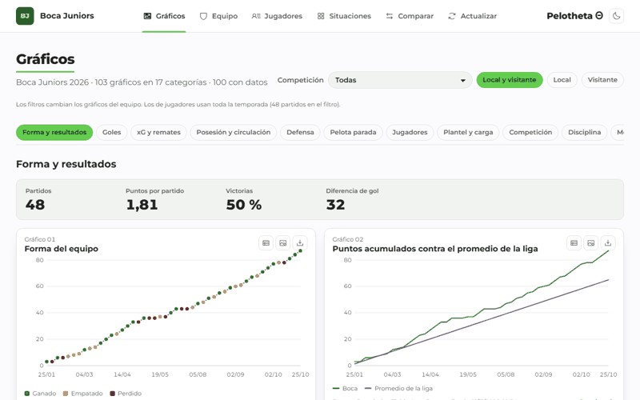

# Pelotheta Θ

**Boca Juniors' 2026 season as data: charts, tables, situational splits, player comparisons and
projections, every number traceable to its source and to the matches behind it.**


**Live:** <https://pelotheta-futbol.vercel.app> (interface in Spanish) · [Versión en español](README.md)



## The problem

Football data about Boca is scattered across sites that show the last match or the league table, but none let
you follow a statistic over time, compare it against the squad, or tell how reliable a number is. Pelotheta Θ
puts the whole season in one free place and explains every number: its source, whether the system computes it
(level A, B or C), whether it is an estimate, and which matches it comes from.

## Features

- **Charts:** 103 charts by category (100 with live data), each with PNG, CSV, table view and "data origin".
- **Team** and **Players:** master tables with percentiles, per-90 values and a context panel.
- **Situations:** 132 cards such as "when Boca is losing at half-time, how does it end?" (123 with data).
- **Compare:** a player against the squad, his zone, his position or another player (never against himself).
- **Drill-down:** double-click any number to see it by time window, with charts and the underlying matches.
- **Exports:** Excel workbooks with native charts and interactive sheets; a Power BI star schema; a
  [read-only API](https://pelotheta-futbol.vercel.app/api-docs) (OpenAPI 3.1); a
  [system status page](https://pelotheta-futbol.vercel.app/estado) with SLOs and data-quality checks.
- **Own metrics:** performance index, Improvement and Potential (two variants each), net rating, a calibrated Elo.

## Stack

Python 3.13 data pipeline on GitHub Actions; Supabase Postgres with row-level security; Next.js 16, React 19
and strict TypeScript on Vercel; Vitest, Playwright and axe; Jupyter and scikit-learn for validation.

## Quick start

```bash
git clone https://github.com/altamirandapatricioseb/Pelotheta-Futbol-.git && cd Pelotheta-Futbol-
cp .env.example .env && cp web/.env.example web/.env.local   # fill in the keys
just bootstrap
just pipeline
just dev                                                     # http://localhost:3000
```

## Highlights for reviewers

- **Security:** public read-only database verified with pgTAP, nonce-based CSP, gitleaks, CodeQL, Semgrep,
  weekly ZAP baseline, encrypted monthly backup with a tested restore, threat model and incident playbooks.
- **Quality:** 558 automated test cases, 0 failing; axe-clean on 14 routes, both themes, desktop and mobile;
  16 hand-written SQL data-quality checks; visual regression; Lighthouse budget in CI.
- **Honest analytics:** the Elo was recalibrated after validation; the "Improvement" metric was shown to
  describe rather than predict; a match-outcome model that did not beat the calibrated Elo was not published.

Full documentation (in Spanish) is linked from [README.md](README.md#documentación).

## License

Code under [MIT](LICENSE). Data belongs to its sources and keeps their licenses (Promiedos/Opta,
ScoutingStats, Statshub, Bzzoiro, StrikerAPI, NoFluffPicks/FootyStats, Open-Meteo CC BY 4.0, Wikipedia
CC BY-SA 4.0). Non-commercial portfolio project.
