# Pelotheta Θ

**La temporada 2026 de Boca Juniors en datos: gráficos, tablas, situaciones, comparaciones y proyecciones,
cada número con su fuente y rastreable hasta el partido que lo origina.**

[](https://github.com/altamirandapatricioseb/Pelotheta-Futbol-/actions/workflows/ci.yml)
[](https://github.com/altamirandapatricioseb/Pelotheta-Futbol-/actions/workflows/codeql.yml)
[](https://github.com/altamirandapatricioseb/Pelotheta-Futbol-/actions/workflows/supply_chain.yml)


**En vivo:** <https://pelotheta-futbol.vercel.app> · [English version](README.en.md)

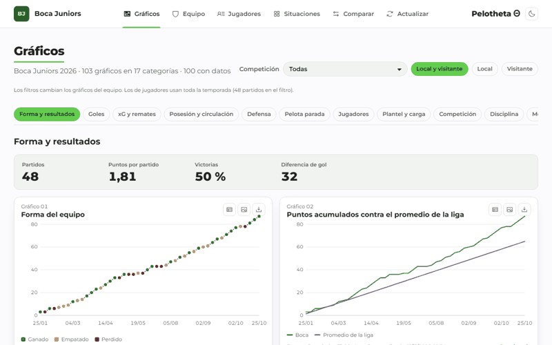

## Qué problema resuelve

Los datos de Boca están repartidos en sitios que muestran el último partido o la tabla, pero no permiten ver
una estadística en el tiempo, compararla contra el plantel ni saber cuándo un número es confiable. Pelotheta Θ
junta la temporada en un solo lugar, gratis y sin cuentas, y explica cada número: de qué fuente sale, si lo
calcula el sistema (nivel A, B o C), si es estimado y de qué partidos viene.

## Funciones principales

| Interfaz | Qué hace |
|---|---|
| [Gráficos](https://pelotheta-futbol.vercel.app/) | 103 gráficos por categoría (100 con datos), con PNG, CSV, tabla y «Ver origen» |
| [Equipo](https://pelotheta-futbol.vercel.app/equipo) | Boca por partido, rival, mes o competición, con su panel de contexto |
| [Jugadores](https://pelotheta-futbol.vercel.app/jugadores) | Tabla maestra del plantel con percentiles, cada 90 y el panel del jugador |
| [Situaciones](https://pelotheta-futbol.vercel.app/situaciones) | 132 tarjetas («cuando pasa X, ¿cómo le va a Boca?»), 123 con datos |
| [Comparar](https://pelotheta-futbol.vercel.app/comparar) | Un jugador contra plantel, zona, posición u otro jugador |
| Estadística desglosada | Doble clic en cualquier número: ventanas de tiempo, gráficos y partidos |
| Actualizar | Dispara la carga de datos desde la web |

Además: libros de Excel con gráficos nativos y hojas interactivas, modelo de Power BI en estrella, una
[API de solo lectura](https://pelotheta-futbol.vercel.app/api-docs), [estado del sistema](https://pelotheta-futbol.vercel.app/estado)
y métricas propias (índice de rendimiento, Mejoría y Potencial α y β, NR, EWA, ELA, Elo calibrado).

| Claro | Oscuro |
|---|---|
| 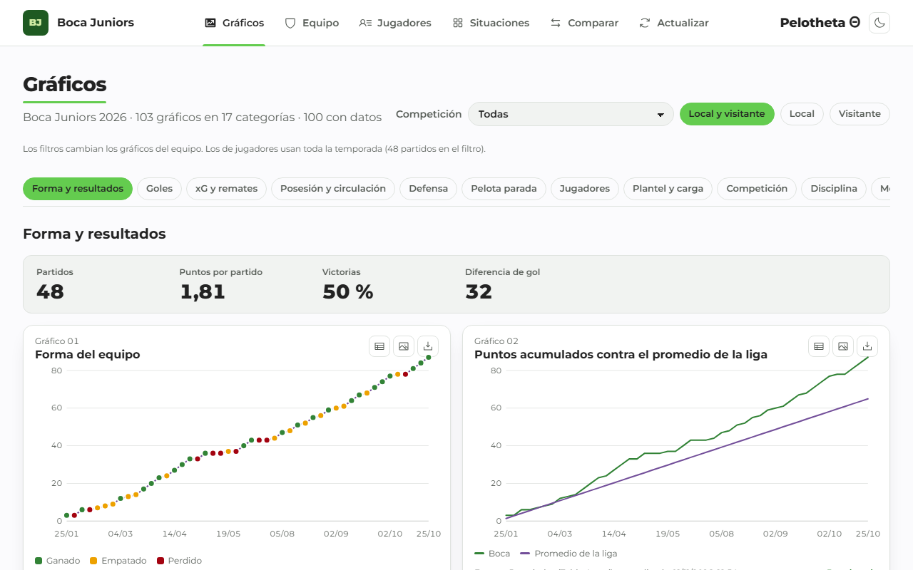 | 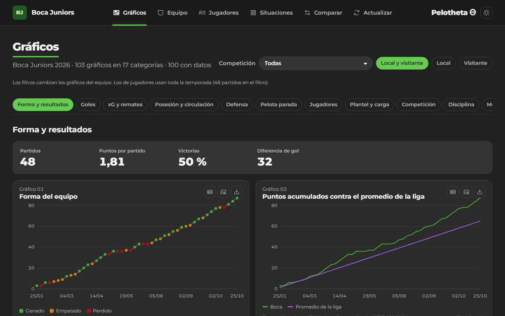 |
| 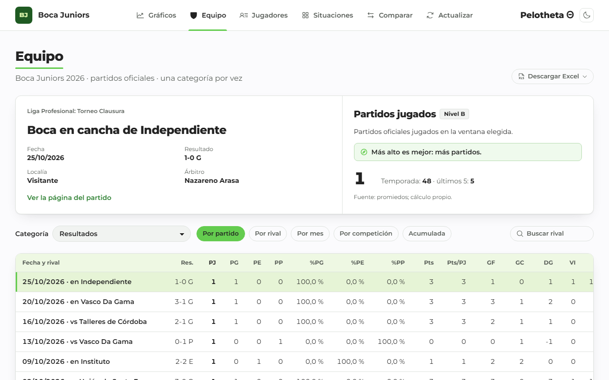 | 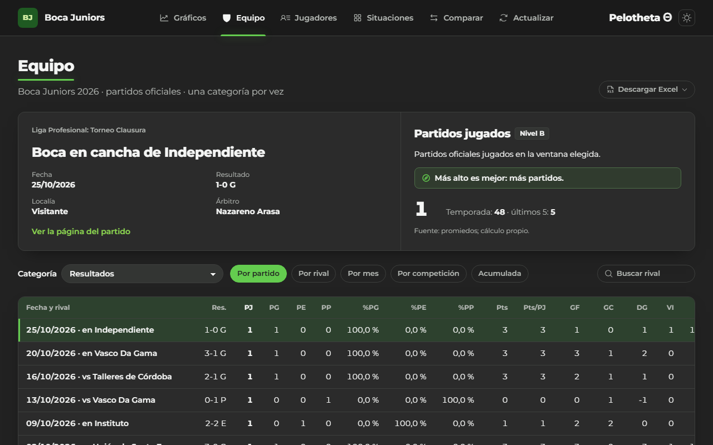 |
| 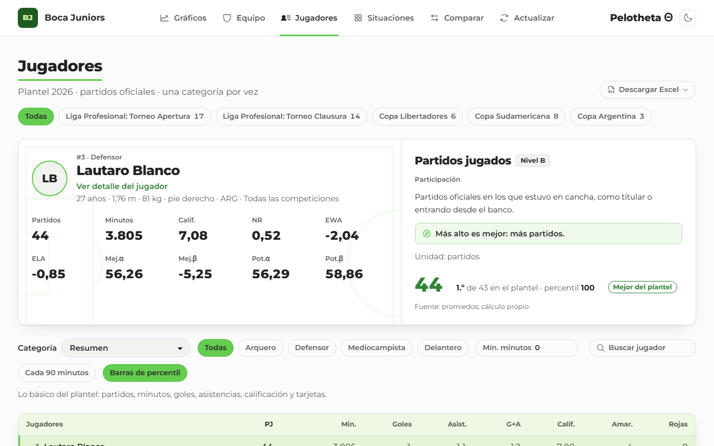 | 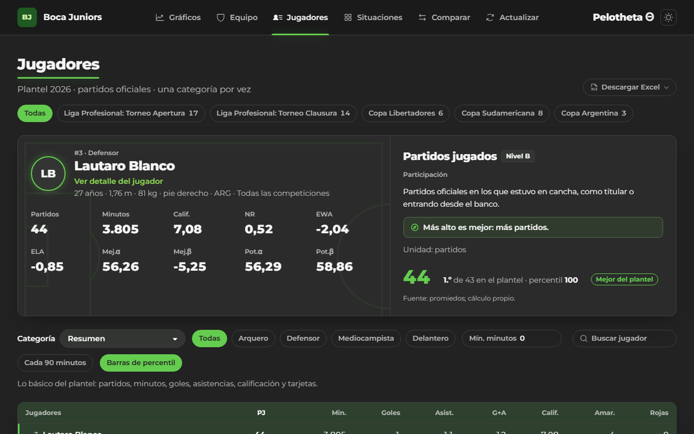 |
| 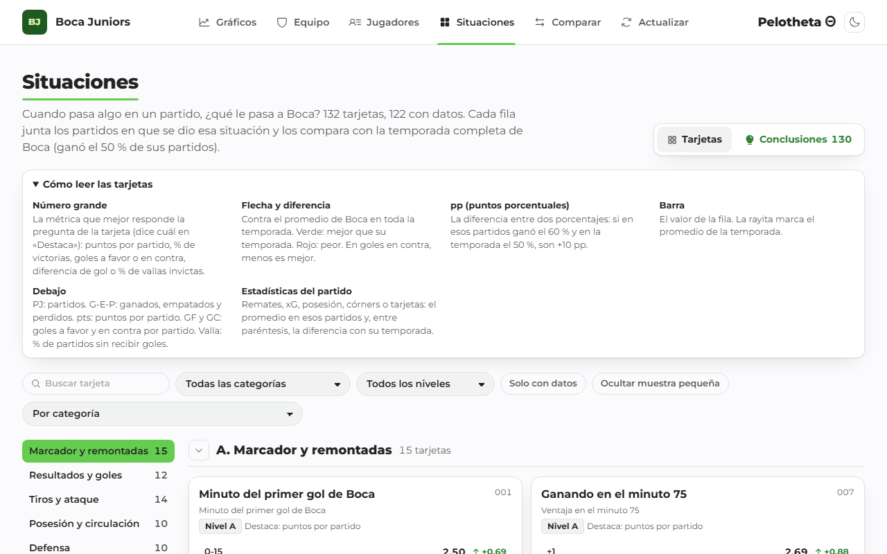 | 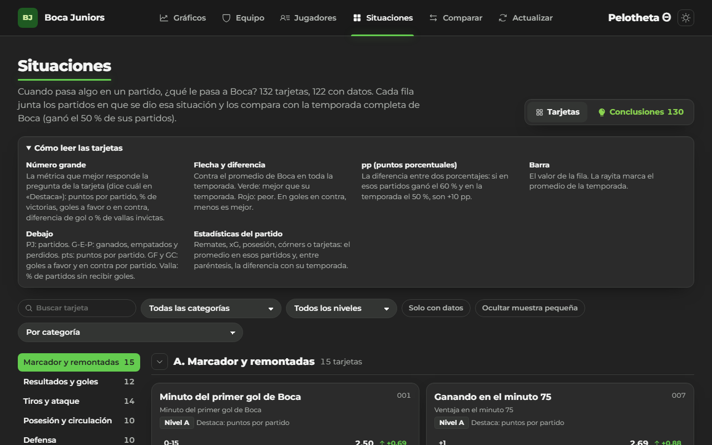 |
| 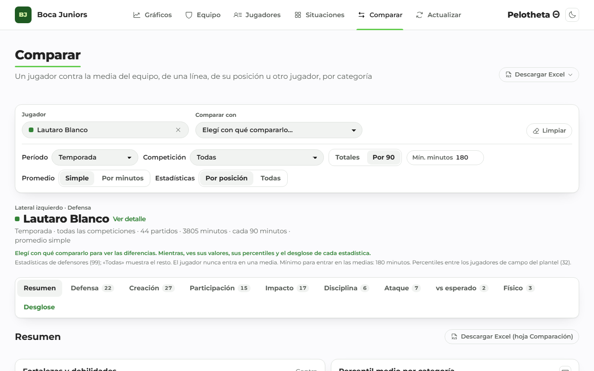 | 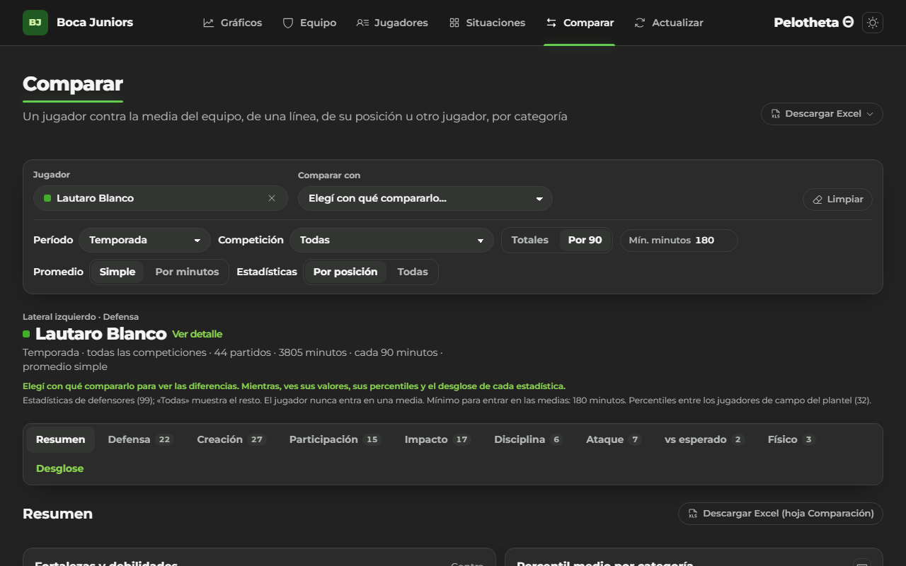 |

## Stack

**Datos:** Python 3.13 (httpx, Pydantic, xlsxwriter), uv y ruff; GitHub Actions. **Base:** Supabase (Postgres
con RLS, Data API, Storage). **Web:** Next.js 16, React 19, TypeScript estricto, Tailwind v4, Motion, Phosphor;
Vitest y Playwright con axe. **Análisis:** Jupyter, scikit-learn, Power BI.

## Arquitectura

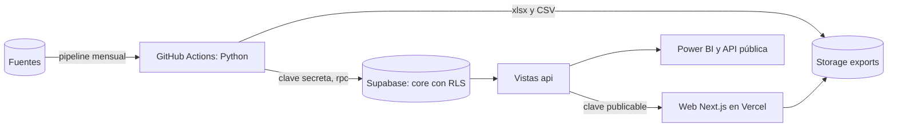

Más diagramas en [`docs/diagramas/`](docs/diagramas/).

## Inicio rápido

```bash
git clone https://github.com/altamirandapatricioseb/Pelotheta-Futbol-.git && cd Pelotheta-Futbol-
cp .env.example .env && cp web/.env.example web/.env.local   # completar las claves
just bootstrap                                               # dependencias, pruebas y build
just pipeline                                                # carga la temporada en Supabase
just dev                                                     # http://localhost:3000
```

## Estructura del repositorio

```
sources/        adaptadores de cada fuente (PoliteClient: pausa, robots.txt, caché)
pipeline/       validación, carga, métricas propias, Excel y Power BI
sql/            consultas escritas a mano (valores por partido, situaciones, desglosada, calidad)
supabase/       migraciones y pruebas pgTAP
web/            sitio Next.js (app, components, lib, e2e)
notebooks/      análisis y validación (Elo, Mejoría, modelo de resultado)
data/           catálogos (estadísticas, gráficos, situaciones), contratos y CSV de Power BI
docs/           documentación (ver abajo)
scripts/        OpenAPI, diccionario, matriz de pruebas, backup y bootstrap
```

## Seguridad

Base de solo lectura para el público (RLS verificada con pgTAP), CSP con nonce, HSTS y cabeceras estrictas,
ninguna clave secreta en el repositorio (gitleaks), CodeQL, Semgrep, Dependabot, ZAP semanal, backup cifrado
mensual, modelo de amenazas y plan de respuesta a incidentes. Ver [`SECURITY.md`](SECURITY.md) y
[`docs/security/`](docs/security/).

## Documentación

| Tema | Documento |
|---|---|
| Producto | [Visión, personas, KPIs y hoja de ruta](docs/producto/vision.md) |
| Requisitos | [Requisitos y trazabilidad](docs/requisitos.md) · [Casos de uso](docs/casos_de_uso.md) |
| Datos | [DER](docs/diagramas/der.md) · [Diccionario](docs/diccionario_datos.md) · [Contratos](data/contracts.yml) · [Glosario](docs/glosario.md) · [Catálogo de estadísticas](docs/catalogo_estadisticas.md) · [Fuentes](docs/source_audit.md) |
| Arquitectura | [Arquitectura, red y linaje](docs/diagramas/arquitectura.md) · [Flujos](docs/diagramas/flujos.md) · [Secuencias](docs/diagramas/secuencias.md) · [ADRs](docs/adr/) · [Red y dominio](docs/red/dominio.md) |
| Métricas | [Métricas propias](docs/metricas_propias.md) · [Fichas de modelos](docs/model_cards/) · [Notebooks](docs/notebooks/) |
| Uso | [Manual de usuario](docs/manual_usuario.md) · [Power BI](docs/powerbi_guia.md) · [Soporte](docs/soporte/README.md) |
| Operación | [Manual técnico](docs/manual_tecnico.md) · [SLOs](docs/slo.md) · [Recuperación](docs/recuperacion.md) |
| Pruebas | [Plan e informe](docs/pruebas/plan_de_pruebas.md) · [Estrategia](docs/pruebas/estrategia.md) · [Matriz de casos](docs/pruebas/matriz_casos_prueba.xlsx) |
| Gestión | [Gestión](docs/gestion/README.md) · [Gantt](docs/gestion/gantt.md) · [Informe de cierre](docs/gestion/informe_cierre.md) · [Ideas extra](docs/ideas_extra.md) |
| Portfolio | [Caso de estudio](docs/portfolio/caso_de_estudio.md) · [Guía de entrevista](docs/portfolio/guia_entrevista.md) · [Puestos](docs/portfolio/puestos.md) |
| Entrega | [PDF único](docs/entrega/Pelotheta_documentacion.pdf) |

## Decisiones clave

- Tablas privadas y vistas `api` de solo lectura ([ADR 0001](docs/adr/0001-esquema-privado-y-api.md)).
- Todo lo calculable se calcula en el pipeline; las fuentes solo dan datos crudos ([ADR 0002](docs/adr/0002-calculo-en-pipeline.md)).
- CSP con nonce por request ([ADR 0003](docs/adr/0003-csp-con-nonce.md)).
- Next.js en Vercel en vez de Streamlit ([ADR 0005](docs/adr/0005-nextjs-frente-a-streamlit.md)).
- No se evaden protecciones de las fuentes ([ADR 0008](docs/adr/0008-no-evadir-protecciones-de-fuentes.md)).

## Hoja de ruta

Landing calculada en el servidor (rendimiento en celular), validación del Potencial α con la temporada 2027 y
una fuente de xG para toda la liga. Detalle en [`docs/producto/vision.md`](docs/producto/vision.md).

## Licencia y fuentes

Código bajo [MIT](LICENSE). Los datos pertenecen a sus fuentes y conservan sus licencias: Promiedos
(estadísticas de Opta), ScoutingStats, Statshub, Bzzoiro, StrikerAPI, NoFluffPicks (datos de FootyStats),
Open-Meteo (CC BY 4.0) y Wikipedia (CC BY-SA 4.0). Proyecto de portfolio sin fines comerciales.
