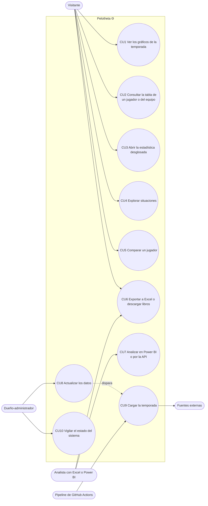

# Casos de uso

El diagrama está en Mermaid (la sección 15 pide PlantUML solo cuando Mermaid no alcanza; acá alcanza y
GitHub lo muestra directo). Exportado a SVG en `docs/diagramas/svg/casos_de_uso-1.svg`.

## Especificación de los 10 principales

### CU1 Ver los gráficos de la temporada
- **Actor:** Visitante. **Precondición:** la base responde.
- **Flujo principal:** 1. Abre `/`. 2. El sistema muestra las categorías con números destacados y ~100
  gráficos. 3. Elige filtros globales (competición, rango). 4. El sistema redibuja los gráficos.
- **Alternativos:** 2a. La base no responde: aviso `PEL-DB-001` con enlace a `/soporte`. 3a. Un gráfico
  sin datos muestra «Sin datos» con el motivo.
- **Postcondición:** ninguna (solo lectura).

### CU2 Consultar la tabla de un jugador o del equipo
- **Actor:** Visitante. **Precondición:** la base responde.
- **Flujo principal:** 1. Abre `/jugadores` o `/equipo`. 2. Elige la categoría (una tabla visible a la vez).
  3. Ordena con un clic en el encabezado. 4. Selecciona una fila y una columna: el panel alto muestra al
  jugador y la descripción de la estadística.
- **Alternativos:** 3a. Segundo clic: orden inverso. 4a. Sin datos: `n/d` en gris.
- **Postcondición:** el estado queda en la URL (se puede compartir).

### CU3 Abrir la estadística desglosada
- **Actor:** Visitante. **Precondición:** la estadística tiene datos.
- **Flujo principal:** 1. Doble clic en una celda, barra, tarjeta o valor de Comparar. 2. El sistema abre
  `/estadistica/[id]` con ventanas de tiempo, gráficos, lista de partidos y relacionadas. 3. Volver.
- **Alternativos:** 1a. Teclado: Enter y D. 2a. Ventana sin partidos: «sin partidos en este período».
- **Postcondición:** al volver, el origen conserva scroll, filtros y elemento enfocado.

### CU4 Explorar situaciones
- **Actor:** Visitante. **Precondición:** tarjetas calculadas.
- **Flujo principal:** 1. Abre `/situaciones`. 2. Elige una categoría. 3. Lee cada fila contra la base de la
  temporada. 4. «Ver los partidos» de una fila.
- **Alternativos:** 3a. Muestra pequeña: aviso. 4a. Doble clic: desglosada.
- **Postcondición:** ninguna.

### CU5 Comparar un jugador
- **Actor:** Visitante. **Precondición:** el jugador tiene minutos.
- **Flujo principal:** 1. Abre `/comparar` y elige un jugador. 2. El sistema muestra categorías y desglose
  contra plantel, zona y posición (sin el jugador en su propia referencia). 3. «Comparar con» otro jugador.
- **Alternativos:** 2a. Referencia sin jugadores suficientes: se explica por qué no hay valor.
- **Postcondición:** el estado queda en la URL.

### CU6 Exportar a Excel o descargar libros
- **Actor:** Visitante o Analista. **Precondición:** ninguna.
- **Flujo principal:** 1. «Exportar a Excel» en una tabla o «Descargar Excel». 2. El sistema genera la vista
  actual en el navegador o entrega el libro del bucket.
- **Alternativos:** 2a. El libro todavía no se regeneró: se descarga el de la carga anterior.
- **Postcondición:** el archivo respeta orden, filtros y columnas visibles.

### CU7 Analizar en Power BI o por la API
- **Actor:** Analista. **Precondición:** clave publicable (pública) o CSV del bucket.
- **Flujo principal:** 1. Lee `/api-docs`. 2. Consulta vistas con `curl`, TypeScript o Power BI. 3. Recibe
  filas en JSON o CSV.
- **Alternativos:** 2a. Intenta escribir: rechazado. 2b. Consulta de más de 3 s: cortada.
- **Postcondición:** ninguna (solo lectura).

### CU8 Actualizar los datos
- **Actor:** Dueño. **Precondición:** token de GitHub configurado en Vercel.
- **Flujo principal:** 1. Abre `/actualizar`. 2. Pulsa Actualizar. 3. El sistema dispara el workflow (CU9) y
  muestra el progreso. 4. Al terminar, refresca.
- **Alternativos:** 2a. Hubo una corrida hace menos de una hora: enfriamiento. 3a. Sin token: `PEL-UPD-001`.
  4a. Falla: `PEL-UPD-003` con el paso.
- **Postcondición:** datos nuevos en la base y caché revalidada.

### CU9 Cargar la temporada
- **Actor:** Pipeline. **Precondición:** clave secreta en GitHub Secrets.
- **Flujo principal:** 1. Verifica la conexión. 2. Lee cada fuente con pausa y robots.txt. 3. Valida y carga
  con upserts. 4. Calcula métricas, corre los chequeos de calidad y registra la corrida. 5. Regenera libros y
  CSV.
- **Alternativos:** 2a. Una fuente cae o bloquea: aviso y sigue. 3a. Registro inválido: cuarentena.
- **Postcondición:** `pipeline_run_metrics` y `data_quality_result` con la corrida nueva.

### CU10 Vigilar el estado del sistema
- **Actor:** Dueño (y cualquiera). **Precondición:** ninguna.
- **Flujo principal:** 1. Abre `/estado`. 2. Ve SLOs, corridas, calidad de datos, cobertura del catálogo y
  fuentes. 3. Si algo falla, sigue el código a `/soporte`.
- **Alternativos:** el control de salud abre un issue solo, sin que nadie mire.
- **Postcondición:** ninguna.
