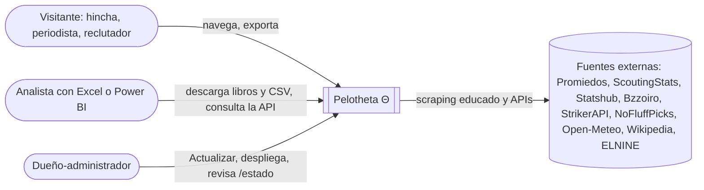
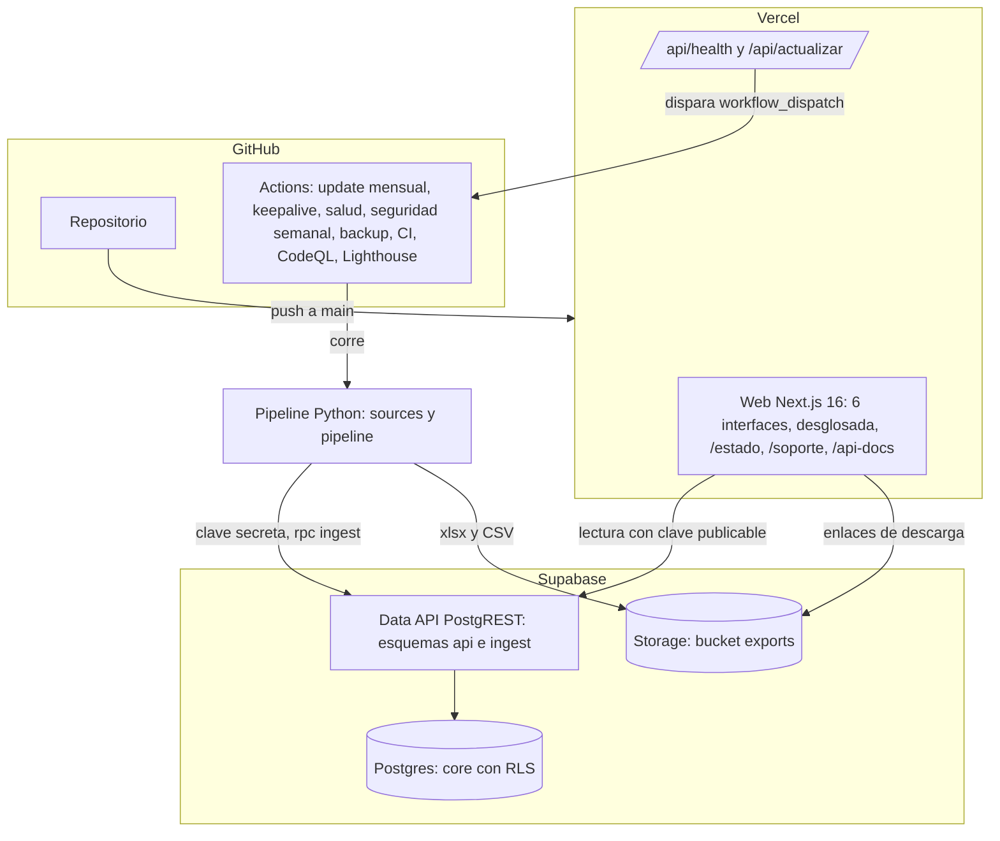
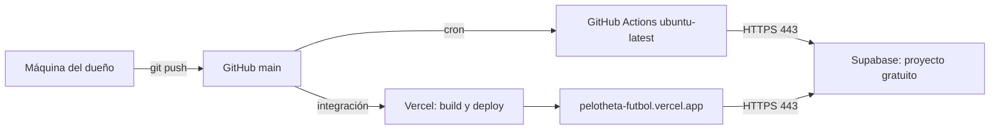
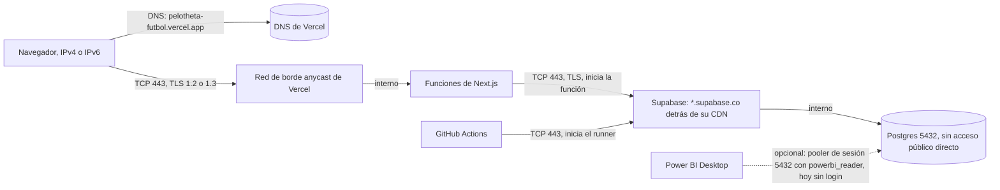
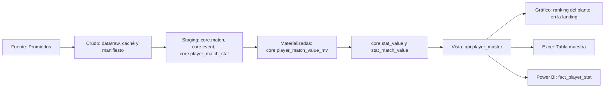

# Arquitectura, despliegue, red y linaje

## C4: contexto

## C4: contenedores

## Despliegue

## Red

Todas las conexiones salen del cliente hacia el servidor: ni Vercel ni Supabase abren conexiones hacia
la máquina del dueño. Detalle de DNS, TLS y dominio propio en `docs/red/dominio.md`.

## Linaje de datos

