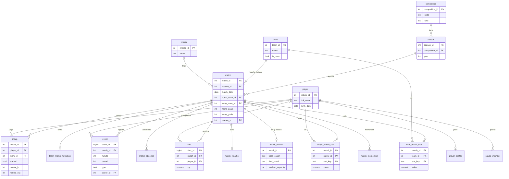
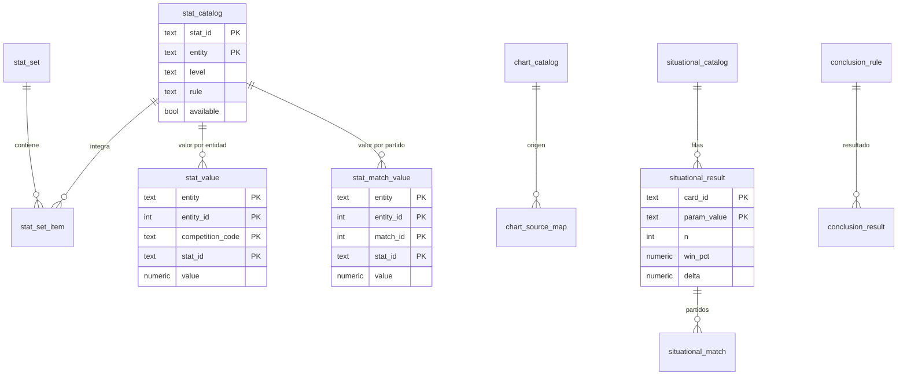
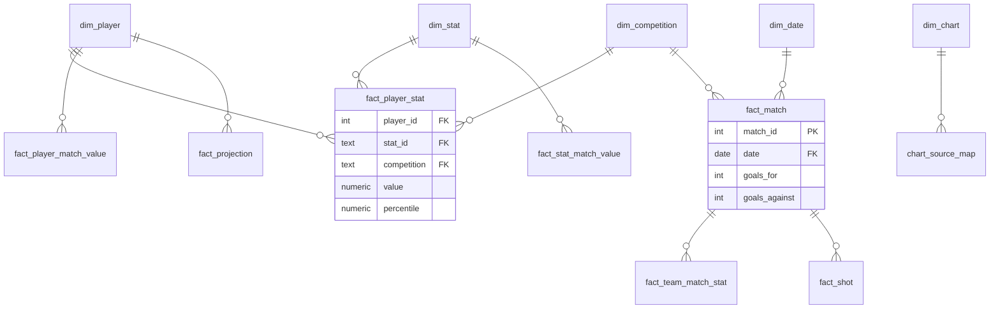

# Diagrama entidad-relación

Dos esquemas: `core` (privado, con RLS; lo escribe solo el pipeline) y `api` (vistas `security_invoker` que
leen la web, Excel, Power BI y la API pública). Las claves foráneas son las reales de la base (2-nov-2026).

## Esquema `core`: partidos, jugadores y eventos

## Esquema `core`: catálogos y resultados calculados

Tablas de operación, sin claves foráneas: `ingest_log`, `audit_log`, `pipeline_run_metrics`,
`data_quality_result`, `system_status`, `source_id_map`, `projection_param`, `league_result`,
`league_standing`, `league_leader`, `club_rating`, `club_season_stat` y `club_competition_metric`.

## Esquema `api`

Cada vista lee una o más tablas de `core` y respeta la RLS de quien consulta (`security_invoker`). Las
principales: `boca_match`, `team_match_master` (un partido con sus estadísticas en JSON), `player_master`
(un jugador por competición con sus estadísticas), `player_match_value`, `team_match_value`,
`stat_match_value`, `stat_catalog`, `chart_catalog`, `situational_result`, `conclusion`, `source_status`,
`pipeline_run_metrics` y `data_quality`. La lista completa con sus columnas: `/api-docs` y
`web/public/openapi.json`.

## Modelo estrella de Power BI

Detalle de cada tabla y medida DAX: `docs/powerbi_guia.md`.
