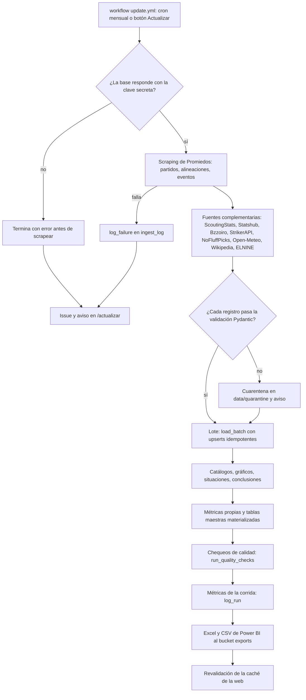
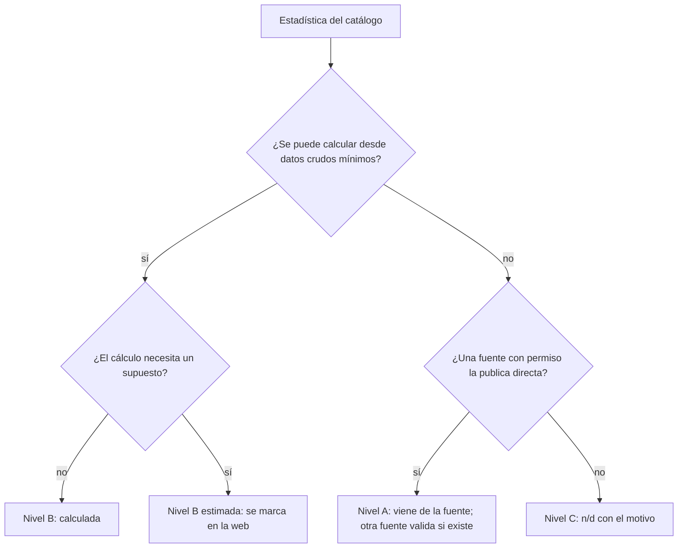
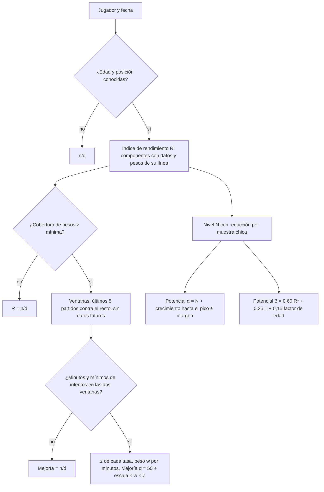
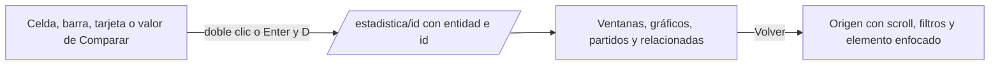
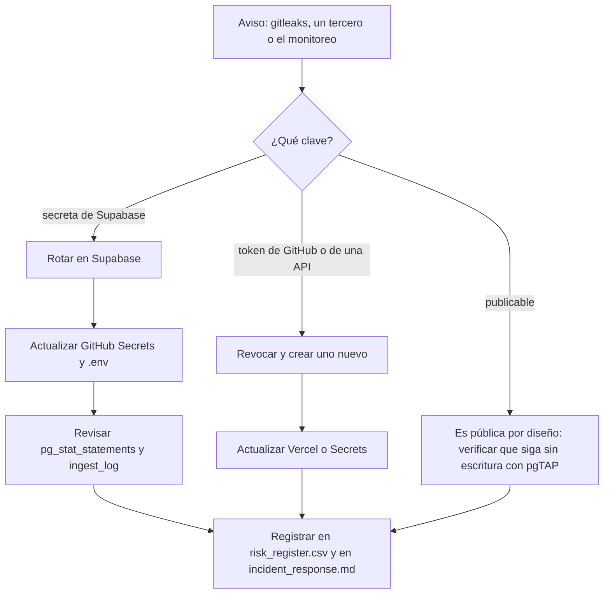
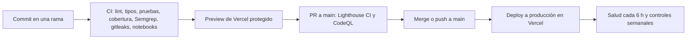

# Diagramas de flujo

## Carga mensual completa

## Nivel A, B o C de una estadística

## Mejoría α y β y Potencial α y β

## Doble clic a la estadística desglosada

## Playbook: clave filtrada

## Ramas, previews y producción

