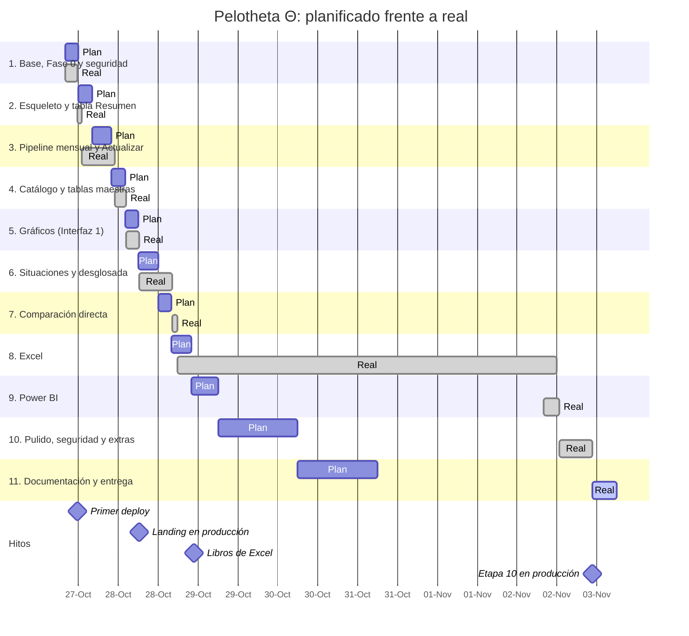

# Gantt (planificado frente a real)

El plan suponía unas 4 a 8 horas por etapa en días seguidos; lo real sale de los commits de cierre de cada
etapa (`git log`). Datos en `gantt.csv`. El hueco del 29 de octubre al 2 de noviembre es una pausa del
proyecto: la etapa 8 cerró su hoja pendiente (Desglosada) el 2 de noviembre.

## Dependencias

Cada etapa depende de la anterior salvo 5, 6 y 8, que dependen del catálogo de la etapa 4 (columna
`depende_de` del CSV).

## Desvíos

| Etapa | Desvío | Causa |
|---|---|---|
| 3 | +4 h | Cierre de seguridad 14.9 y keepalive dos veces por semana |
| 6 | +4 h | Más conclusiones y tarjetas que las pedidas |
| 8 a 11 | +4 días | Pausa entre el 29-oct y el 2-nov |
| 10 | +4 h | Repositorio privado: soporte, reporte y contacto rediseñados; calibración del Elo |
