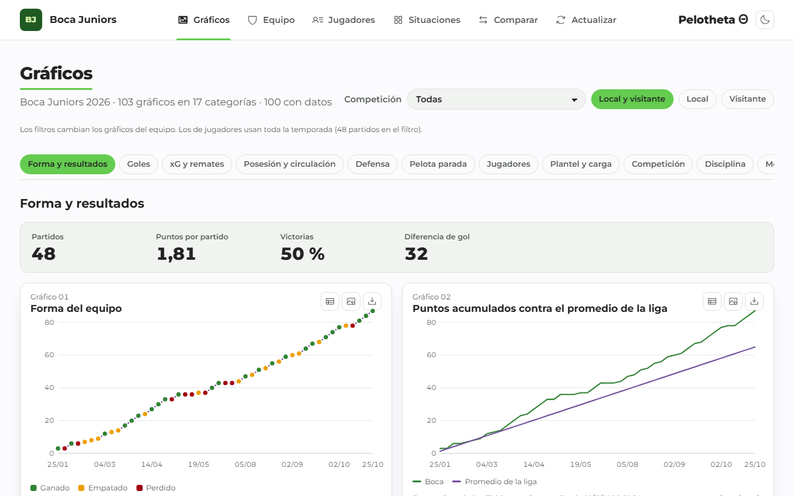
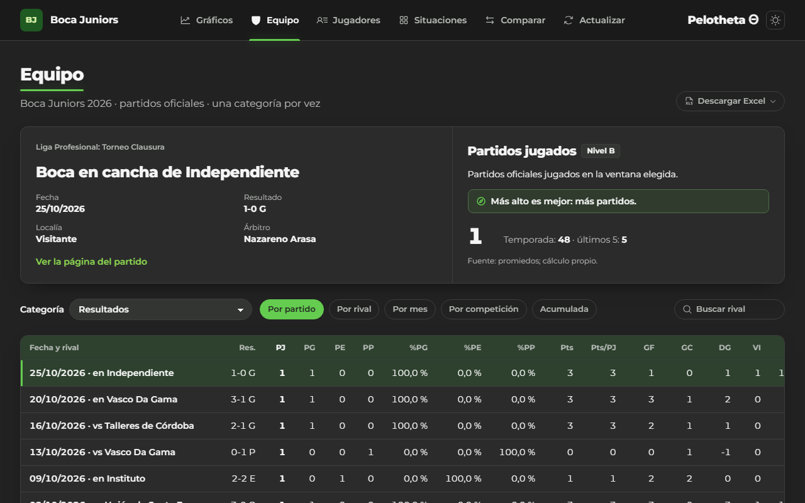
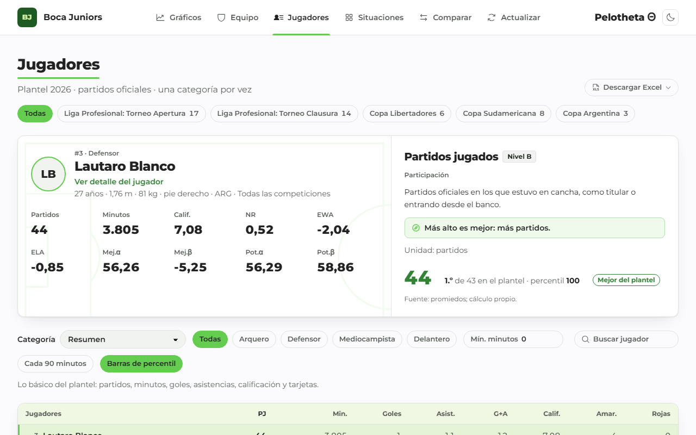
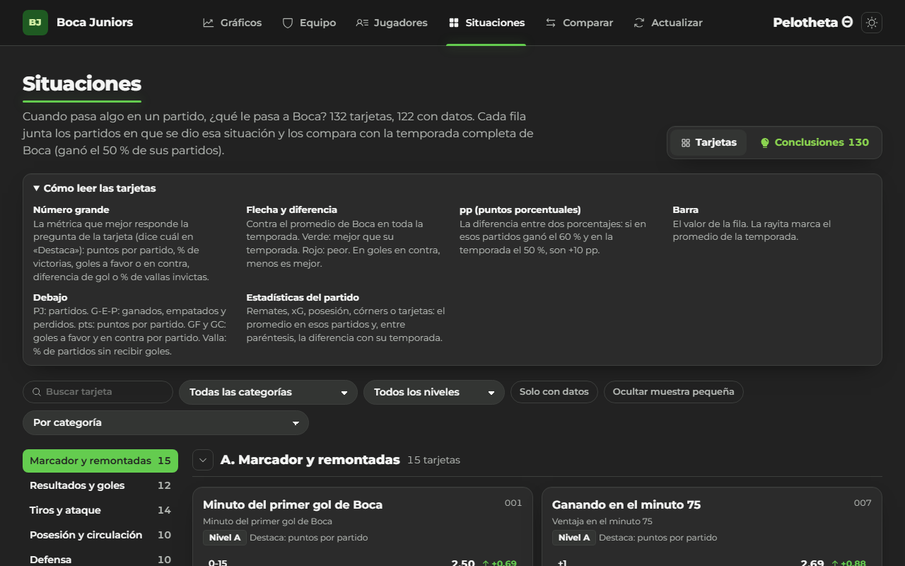
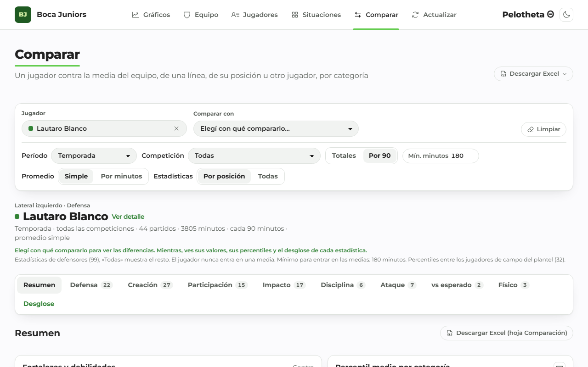
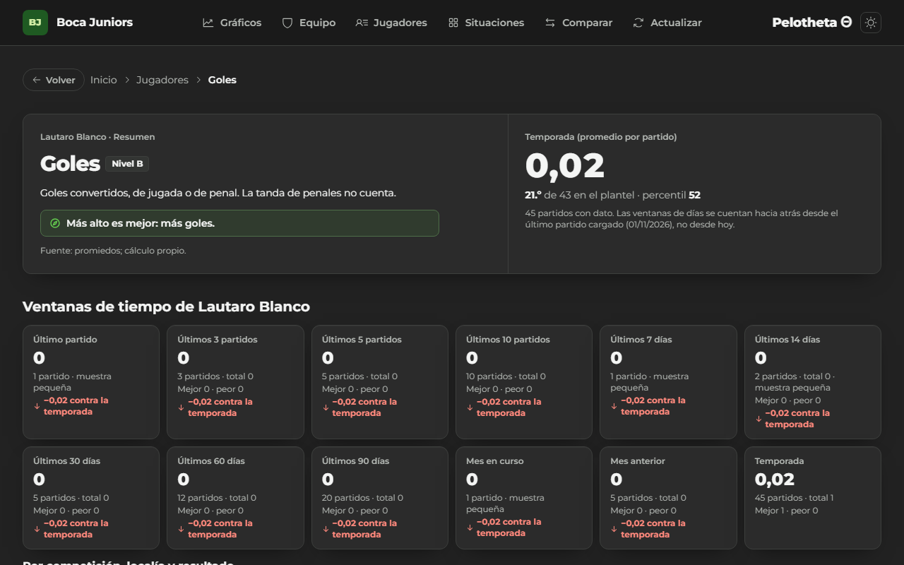

# Manual de usuario

Pelotheta Θ muestra la temporada de Boca Juniors en cinco interfaces, una página de estadística desglosada
y una para actualizar los datos. Dirección: <https://pelotheta-futbol.vercel.app>. Las capturas las genera
`web/scripts/capturas.ts` y se actualizan solas.

## Lo común a todas las páginas

- **Header:** a la izquierda, Boca Juniors (vuelve al inicio); al centro, las interfaces; a la derecha, el
  nombre del sistema y el botón de tema claro u oscuro (el cambio entra como un círculo desde el botón).
- **Frescura:** la franja del header dice cuándo se actualizaron los datos.
- **`n/d`:** el dato no existe en ninguna fuente o no alcanza la muestra. Nunca es cero.
- **Nivel A, B o C:** A viene de una fuente; B lo calcula el sistema; C no tiene dato. «Estimada» quiere decir
  que el cálculo usa un supuesto.
- **Estado en la dirección:** filtros, jugador y estadística quedan en la URL; se puede compartir el enlace.
- **Errores:** cada aviso trae un código y el enlace «Qué significa este código» a `/soporte`.

## Gráficos (inicio)

Más de 100 gráficos por categoría con números destacados arriba de cada sección. La barra de categorías
acompaña el scroll. Cada gráfico tiene «Ver como tabla», «Descargar PNG», «Descargar los datos (CSV)»,
«Desglosada» y «Ver origen de los datos». Doble clic sobre el gráfico abre la estadística desglosada.

## Equipo

Boca por partido, por rival, por mes, por competición o acumulado. Se elige la categoría de estadísticas
(una tabla visible a la vez); un clic en el encabezado ordena y otro invierte. Doble clic en el nombre de un
partido abre su página; doble clic en una celda, la desglosada.

## Jugadores

Tabla maestra del plantel: al seleccionar una fila y una columna, el panel alto muestra al jugador y la
explicación de la estadística (nivel, unidad, si más es mejor, puesto y percentil en el plantel). Filtros por
competición, línea, minutos mínimos y búsqueda; «Cada 90 minutos» y «Barras de percentil». Doble clic en el
nombre abre el detalle del jugador.

## Situaciones

Más de 100 tarjetas del tipo «cuando pasa X, ¿cómo le va a Boca?». Cada fila compara con la temporada
completa (verde mejor, rojo peor, siempre con el texto). «Ver los partidos» lista los partidos de la fila.

## Comparar

Elegí un jugador y se compara contra el plantel, su zona y su posición (sin contarlo a él en la referencia).
«Comparar con» suma otro jugador. Cada categoría tiene su gráfico y su desglose.

## Valor

Cada jugador con su valor de mercado real contra el que se esperaría para alguien de su edad, posición,
contrato, nacionalidad y club (aprendido con toda la liga) y corregido por su rendimiento. Tocá un jugador de la
tabla para abrir su pantalla: de dónde sale su precio paso a paso, su historial de valor, dónde queda en la liga
y en el plantel, sus comparables y su rendimiento. «¿Paga el rendimiento?» dice si los que rinden más valen más de lo que sus
papeles dirían. El error se mide sin trampa (sin el club en el entrenamiento) y se explica al pasar el mouse.

## Alternativas

Elegí un jugador del plantel y aparecen tres listas, de la opción más parecida a la menos: un jugador de otro
club, una dupla de otro club (con precios, tiene que costar menos que el original) y un compañero. El parecido
sale de 17 estadísticas cada 90 minutos llevadas a la misma escala. Tocá una opción para ver la comparación
completa: perfil, qué se gana y qué se pierde, dónde están las diferencias y el mapa de precio contra parecido.
Las dos primeras listas se llenan cuando hay estadísticas de jugadores de otros clubes.

## Predictor

Por defecto compara contra el equipo promedio de la liga. Elegí el país del rival, su liga y el equipo, o quedate
con la media de una liga, de un país o de toda la zona (Argentina, Brasil y Colombia con datos abiertos; los
rivales de copa de Chile, Ecuador o Paraguay y uno genérico de Primera Nacional, con supuestos), y si se juega de
local, de visitante o en cancha neutral: probabilidad de ganar, empatar y perder, los marcadores más probables y
la matriz completa. Mira los goles que hace y recibe cada equipo (con más peso a lo reciente), el valor de cada plantel y
la localía; «Qué estadísticas usa» muestra las combinaciones probadas y por qué quedó esa. Un rival sin datos se
marca como supuesto. No son cuotas de apuestas.

## Ojeador

Informes como los de un ojeador. Arriba, la matriz de profundidad y edades: cada puesto contra cinco franjas de
edad, con cada jugador más violeta cuantos más minutos jugó. Después, «Lo que le falta al plantel»: una nota de
necesidad de 0 a 10 por puesto (profundidad, nivel de los titulares en las estadísticas del puesto, titulares
veteranos y contratos que terminan), los motivos, lo más flojo de los titulares y un mapa de calor con todos los
jugadores del puesto y su percentil en cada estadística relevante (contra el plantel hoy; contra la liga cuando
estén las estadísticas de los otros clubes). Abajo, los informes de jugadores de otros clubes en tres categorías
(por necesidad, oportunidades de mercado y jóvenes promesas de hasta 21 años) con filtro por puesto y un gráfico de
nivel contra valor. Cada informe trae nota de 0 a 10, veredicto (fichar, seguir de cerca u opción de reserva),
barras de nivel actual y potencial (0 a 100, relativas a los titulares propios del puesto), valor contra la
mediana de su puesto y edad, en qué es bueno, y a favor y en contra. «Ver informe completo» (o tocar su punto
en el gráfico) abre su página: el resumen, su precio contra el de todos los de su puesto en la liga por edad (con la
mediana y los del plantel propio marcados), lo mejor y lo peor de su juego y una tabla con todas las estadísticas del
catálogo del puesto (las mismas que tienen los jugadores propios): su valor, su percentil en la liga, la mediana de
la liga y la de los titulares propios. Mientras falten sus estadísticas, la tabla muestra contra qué se lo va a medir. Colores: verde lo muy bueno (percentil 70 o más, necesidad de 3 o menos, a favor), rojo lo preocupante
(percentil 30 o menos, necesidad de 6 o más, en contra) y violeta lo intermedio. Todo se recalcula con lo cargado: cambia con el plantel, el mercado y el equipo elegido.

## Estadística desglosada

Una estadística de un jugador o del equipo por ventanas de tiempo (último partido, últimos 3, 5 y 10, días,
meses, local y visitante, por resultado, por rival), con gráficos, el último partido y la lista de partidos.
Las ventanas de días se cuentan desde el último partido cargado. «Muestra pequeña» con menos de 3 partidos.

## Atajos de teclado

| Atajo | Dónde | Qué hace |
|---|---|---|
| Tab y Mayúsculas + Tab | Todo el sitio | Recorre enlaces y controles; «Saltar al contenido» es el primero |
| Flechas arriba y abajo | Tablas | Mueve la fila seleccionada |
| Enter y después D | Tablas, gráficos y tarjetas | Abre la estadística desglosada |
| Escape | Menús y paneles | Cierra |

## Exportaciones

- **Exportar a Excel** en cada tabla: la vista actual con su orden, filtros y columnas, con estilos.
- **Descargar Excel:** libros completos (global y por competición) con gráficos nativos y hojas interactivas
  (`Comparador`, `Dispersión`, `Proyección` y `Desglosada`).
- **PNG y CSV** de cada gráfico.
- **API:** `/api-docs` explica cómo consultar los datos directamente.

## Cómo leer las métricas propias

| Métrica | Qué dice | Cómo leerla |
|---|---|---|
| NR | Diferencia de gol cada 90 minutos con el jugador en cancha | Más alto es mejor; el NR relativo lo compara con el reemplazo |
| EWA y ELA | Victorias que agrega en ataque (EWA) y que cuesta en defensa (ELA) frente al reemplazo | EWA alto es mejor; **ELA negativo es bueno** |
| Índice de rendimiento | Percentiles de ataque, creación, defensa, eficiencia y participación ponderados por la línea | 50 es el promedio del plantel |
| Mejoría α y β | Cómo rindió en los últimos 5 partidos contra el resto de la temporada | **Describe** el pasado reciente; la validación mostró que no anticipa el bloque siguiente |
| Potencial α y β | Hasta dónde podría llegar según nivel, edad y tendencia | Es una estimación con rango; con poca muestra se avisa |
| Elo | Fuerza del equipo, se actualiza con cada resultado | K = 30 y localía de 50 puntos, calibrados con la liga 2026 |

## Preguntas frecuentes

- **¿Por qué un dato dice `n/d`?** Ninguna fuente lo publica o no alcanza la muestra; `/estado` muestra qué
  fuente falló.
- **¿Cada cuánto se actualiza?** Una vez por mes automáticamente; el dueño puede adelantarlo desde
  `/actualizar`.
- **¿Puedo usar los datos?** Sí, para consultarlos; los datos de terceros conservan sus licencias (ver
  `/privacidad`).
- **Encontré un dato mal.** Escribí al responsable desde su perfil de GitHub (enlace en `/privacidad`).
