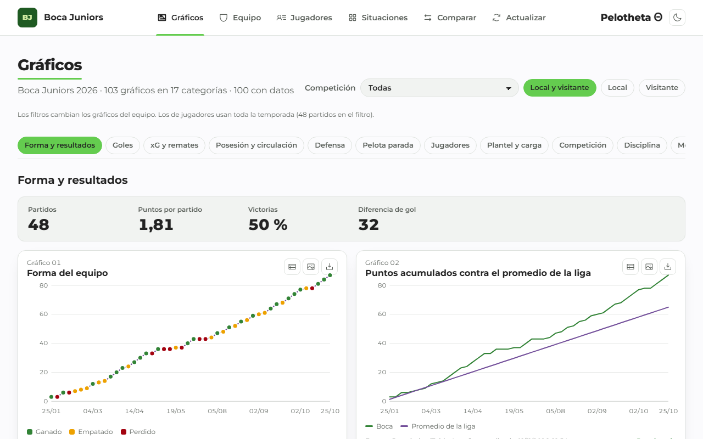
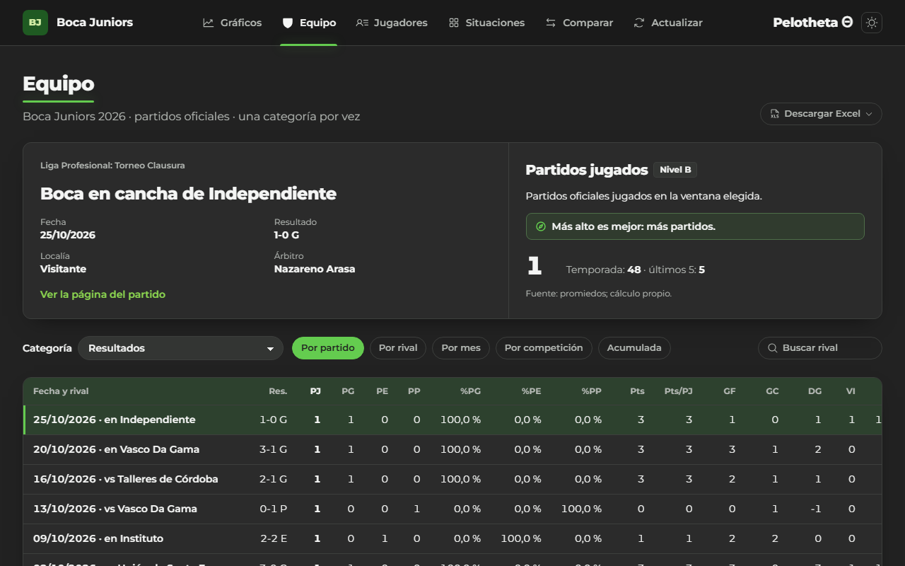
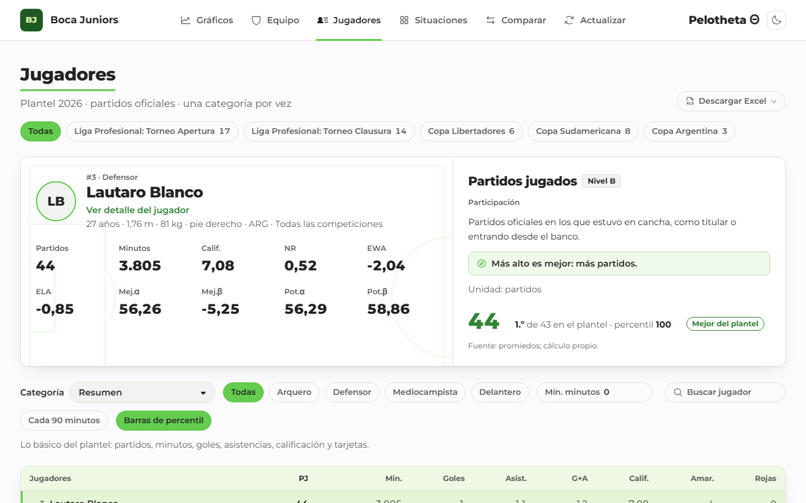
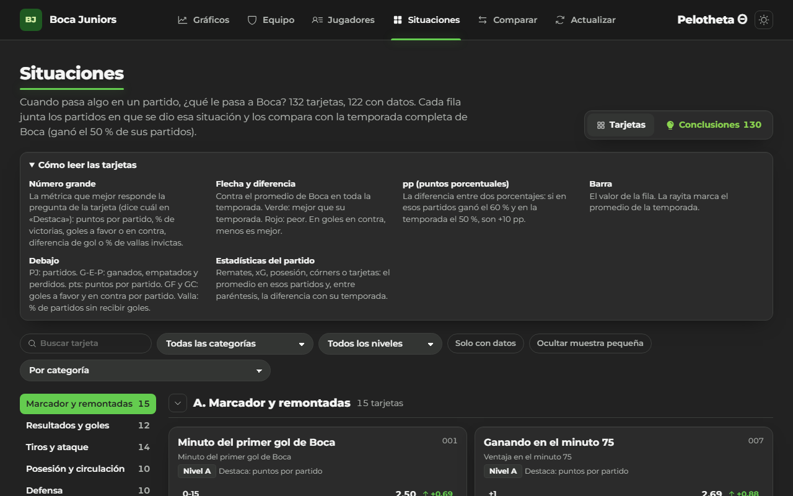
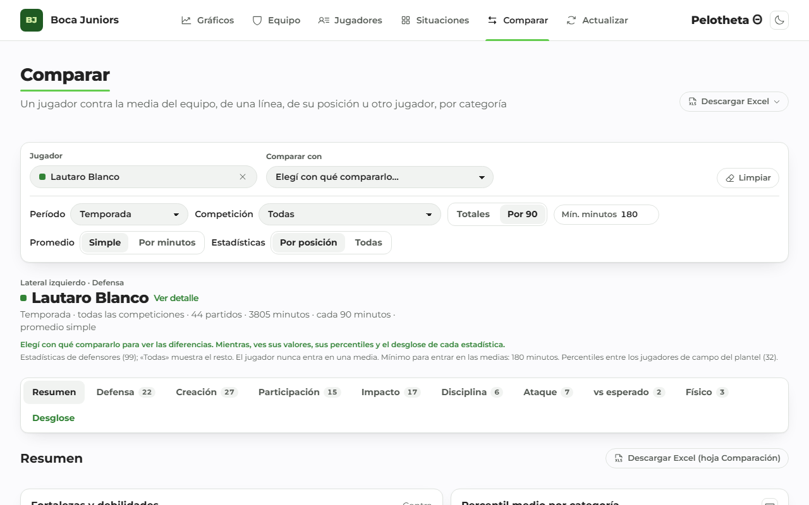
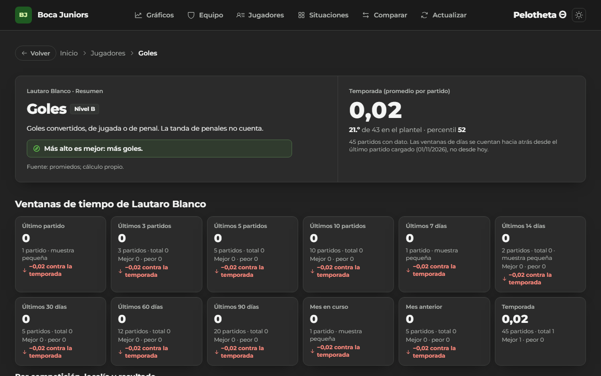

# Manual de usuario

Pelotheta Θ muestra la temporada de Boca Juniors en cinco interfaces, una página de estadística desglosada
y una para actualizar los datos. Dirección: <https://pelotheta-futbol.vercel.app>. Las capturas las genera
`web/scripts/capturas.ts` y se actualizan solas.

## Lo común a todas las páginas

- **Header:** a la izquierda, Boca Juniors (vuelve al inicio); al centro, las interfaces; a la derecha, el
  nombre del sistema y el botón de tema claro u oscuro (el cambio entra como un círculo desde el botón).
- **Frescura:** la franja del header dice cuándo se actualizaron los datos.
- **`n/d`:** el dato no existe en ninguna fuente o no alcanza la muestra. Nunca es cero.
- **Nivel A, B o C:** A viene de una fuente; B lo calcula el sistema; C no tiene dato. «Estimada» quiere decir
  que el cálculo usa un supuesto.
- **Estado en la dirección:** filtros, jugador y estadística quedan en la URL; se puede compartir el enlace.
- **Errores:** cada aviso trae un código y el enlace «Qué significa este código» a `/soporte`.

## Gráficos (inicio)

Más de 100 gráficos por categoría con números destacados arriba de cada sección. La barra de categorías
acompaña el scroll. Cada gráfico tiene «Ver como tabla», «Descargar PNG», «Descargar los datos (CSV)»,
«Desglosada» y «Ver origen de los datos». Doble clic sobre el gráfico abre la estadística desglosada.

## Equipo

Boca por partido, por rival, por mes, por competición o acumulado. Se elige la categoría de estadísticas
(una tabla visible a la vez); un clic en el encabezado ordena y otro invierte. Doble clic en el nombre de un
partido abre su página; doble clic en una celda, la desglosada.

## Jugadores

Tabla maestra del plantel: al seleccionar una fila y una columna, el panel alto muestra al jugador y la
explicación de la estadística (nivel, unidad, si más es mejor, puesto y percentil en el plantel). Filtros por
competición, línea, minutos mínimos y búsqueda; «Cada 90 minutos» y «Barras de percentil». Doble clic en el
nombre abre el detalle del jugador.

## Situaciones

Más de 100 tarjetas del tipo «cuando pasa X, ¿cómo le va a Boca?». Cada fila compara con la temporada
completa (verde mejor, rojo peor, siempre con el texto). «Ver los partidos» lista los partidos de la fila.

## Comparar

Elegí un jugador y se compara contra el plantel, su zona y su posición (sin contarlo a él en la referencia).
«Comparar con» suma otro jugador. Cada categoría tiene su gráfico y su desglose.

## Estadística desglosada

Una estadística de un jugador o del equipo por ventanas de tiempo (último partido, últimos 3, 5 y 10, días,
meses, local y visitante, por resultado, por rival), con gráficos, el último partido y la lista de partidos.
Las ventanas de días se cuentan desde el último partido cargado. «Muestra pequeña» con menos de 3 partidos.

## Atajos de teclado

| Atajo | Dónde | Qué hace |
|---|---|---|
| Tab y Mayúsculas + Tab | Todo el sitio | Recorre enlaces y controles; «Saltar al contenido» es el primero |
| Flechas arriba y abajo | Tablas | Mueve la fila seleccionada |
| Enter y después D | Tablas, gráficos y tarjetas | Abre la estadística desglosada |
| Escape | Menús y paneles | Cierra |

## Exportaciones

- **Exportar a Excel** en cada tabla: la vista actual con su orden, filtros y columnas, con estilos.
- **Descargar Excel:** libros completos (global y por competición) con gráficos nativos y hojas interactivas
  (`Comparador`, `Dispersión`, `Proyección` y `Desglosada`).
- **PNG y CSV** de cada gráfico.
- **API:** `/api-docs` explica cómo consultar los datos directamente.

## Cómo leer las métricas propias

| Métrica | Qué dice | Cómo leerla |
|---|---|---|
| NR | Diferencia de gol cada 90 minutos con el jugador en cancha | Más alto es mejor; el NR relativo lo compara con el reemplazo |
| EWA y ELA | Victorias que agrega en ataque (EWA) y que cuesta en defensa (ELA) frente al reemplazo | EWA alto es mejor; **ELA negativo es bueno** |
| Índice de rendimiento | Percentiles de ataque, creación, defensa, eficiencia y participación ponderados por la línea | 50 es el promedio del plantel |
| Mejoría α y β | Cómo rindió en los últimos 5 partidos contra el resto de la temporada | **Describe** el pasado reciente; la validación mostró que no anticipa el bloque siguiente |
| Potencial α y β | Hasta dónde podría llegar según nivel, edad y tendencia | Es una estimación con rango; con poca muestra se avisa |
| Elo | Fuerza del equipo, se actualiza con cada resultado | K = 30 y localía de 50 puntos, calibrados con la liga 2026 |

## Preguntas frecuentes

- **¿Por qué un dato dice `n/d`?** Ninguna fuente lo publica o no alcanza la muestra; `/estado` muestra qué
  fuente falló.
- **¿Cada cuánto se actualiza?** Una vez por mes automáticamente; el dueño puede adelantarlo desde
  `/actualizar`.
- **¿Puedo usar los datos?** Sí, para consultarlos; los datos de terceros conservan sus licencias (ver
  `/privacidad`).
- **Encontré un dato mal.** Escribí al responsable desde su perfil de GitHub (enlace en `/privacidad`).
