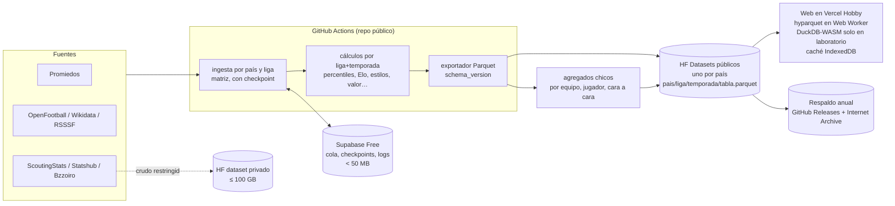

# Plan: escalar Pelotheta Θ a toda la Conmebol (costo USD 0)

Fecha de medición y verificación: **23-nov-2026**. Estado: **propuesta, sin implementar**. Nada de esto crea cuentas ni publica datos hasta que el dueño apruebe cada etapa.

## 0. Requisito del dueño (26-nov-2026) y plan reestructurado

**Requisito innegociable**: análisis profundo de **todos los equipos de todas las ligas y países que lista el sistema** (`web/config/teams.ts`): Argentina (Primera, Primera Nacional, Primera B, Federal A), Brasil (Série A y B) y la primera de Uruguay, Chile, Colombia, Paraguay, Ecuador, Perú, Bolivia y Venezuela: 14 competiciones, ~380 equipos. Costo USD 0 sin tarjeta; nada en disco local.

**Consecuencia de arquitectura (medida, no estimada)**: el detalle por partido ocupa ~900 KB en Postgres y ~10 KB en Parquet zstd (las 76 estadísticas por jugador de los 502 partidos de la Liga Profesional ocupan 583 KB). Las 14 competiciones son ~5 500 partidos por temporada: ~5 GB en Postgres (no entra en ningún plan gratis) contra **~55 MB en Parquet**; 20 temporadas, ~1,1 GB. Por eso el análisis profundo de todos los equipos sale de **Parquet**, no de Supabase:

| Capa | Servicio (gratis, sin tarjeta) | Rol |
|---|---|---|
| Cálculo | GitHub Actions | baja las fuentes y calcula por liga (Python; DuckDB donde el SQL de las vistas se reusa) |
| Datos | Hugging Face Datasets | todo el detalle y los resultados calculados: público (derivados y fuentes abiertas) y privado (crudo restringido, 100 GB) |
| Web | Vercel Hobby | lee Parquet en el servidor con caché de 1 h (`web/lib/data/parquet.ts`) |
| Cola | Supabase Free | estado del pipeline y Boca en vivo hasta migrarlo; deja de ser almacenamiento |

Descartados: Cloudflare R2 (pide tarjeta), Neon (1 GB por proyecto: una temporada de la Conmebol en Postgres no entra), Postgres para el detalle (100 veces más pesado).

**Cobertura de fuentes por competición (verificada el 26-nov)**:

| Competición | Partidos y eventos | Estadísticas por jugador | Nivel alcanzable hoy |
|---|---|---|---|
| Argentina Primera | Promiedos | Bzzoiro | profundo |
| Argentina Primera Nacional | Promiedos | ScoutingStats (liga 645) | profundo |
| Argentina Primera B | Promiedos | — (falta fuente) | medio: alineaciones, minutos, goles, tarjetas, cambios |
| Argentina Federal A | Promiedos | — (falta fuente) | medio |
| Brasil Série A | Promiedos | Bzzoiro, ScoutingStats | profundo |
| Brasil Série B | Bzzoiro | Bzzoiro, ScoutingStats | profundo |
| Uruguay | Promiedos | ScoutingStats (770) | profundo |
| Chile | Promiedos | Bzzoiro, ScoutingStats (663) | profundo |
| Colombia | Promiedos | Bzzoiro, ScoutingStats | profundo |
| Paraguay | Promiedos | — (falta fuente) | medio |
| Ecuador | Bzzoiro | Bzzoiro, ScoutingStats | profundo |
| Perú | Bzzoiro | Bzzoiro, ScoutingStats (764) | profundo |
| Bolivia | Wikipedia en español (tablas por fecha del artículo de la temporada; CC BY-SA, `?action=raw` permitido por robots) | — (la API de la FBF publica 5 partidos de primera y sin goles; ninguna otra fuente permitida) | medio-bajo: resultados con fecha y estadio, tabla calculada, situaciones sin minutos (5j-7) |
| Venezuela | ScoutingStats | ScoutingStats (800) | profundo |

Revisado y descartado: Hugging Face no tiene datasets abiertos de estas ligas (los que hay copian Sofascore, sin licencia); Sofascore, FotMob, OneFootball, ESPN, Transfermarkt, Soccerway y FBref prohíben el uso por términos; API-Football gratis solo da 2022 a 2024.

**Subetapas nuevas de la etapa 5** (cada una con su commit; lo que pide una cuenta o un clic del dueño queda como pendiente y no frena lo demás):

- **5j-1**: el exportador particiona por liga según la fila (`pais=`, `liga=`), no por una liga fija.
- **5j-2**: Bzzoiro para sus 13 competiciones de la Conmebol, con tope de consultas por corrida y continuación desde la caché (cuota de 7 500 por día).
- **5j-3**: ScoutingStats por liga (Primera Nacional, Uruguay, Venezuela y las que coinciden): crudo privado, perfiles públicos.
- **5j-4**: Promiedos por liga (resultados con minutos, tablas, próximos partidos) para todas las que publica.
- **5j-5**: la web: índice de clubes por país y liga, y la ficha de cualquier club con todo lo que su liga tenga.
- **5j-6**: buscar fuentes para Primera B, Federal A, Paraguay y Bolivia. Hecho el 26-nov: Bolivia no está en Promiedos, Bzzoiro ni ScoutingStats, y la API de la FBF resultó casi vacía (5 partidos de primera, sin goles); para Paraguay, Primera B y Federal A no apareció ninguna fuente gratis y permitida con estadísticas por jugador (Hugging Face, ScoutingStats, Bzzoiro y las federaciones revisadas). Quedan en nivel medio con Promiedos.
- **5j-7**: Bolivia desde Wikipedia en español: resultados fecha por fecha (208 partidos de 2026 al 26-nov), tabla calculada (coincide con la oficial) y situaciones sin lo que depende del minuto. El mismo lector sirve para temporadas pasadas de cualquier liga con artículo (etapa 9). La ficha oculta «marcó primero», el descanso y los tramos de 15 minutos cuando la fuente no da minutos.

**Estado del 26-nov (commits en `feat/escala-conmebol`)**: 5j-1 a 5j-7 hechas. Pendientes del dueño: subir la rama, unirla a `main` y lanzar «Exportar Parquet» varias veces (cada corrida completa más partidos por los topes de Bzzoiro, ScoutingStats y Promiedos). Pendientes técnicos: unificar nombres de clubes entre Bzzoiro/ScoutingStats y Promiedos fuera de Argentina (hoy solo Argentina tiene la lista); las páginas de análisis profundo (Partido, Jugador, Comparar, Equipo) leyendo Parquet para cualquier club.

## 1. Resumen en cinco líneas

1. **Se puede hacer gratis**, y el número que importa es mucho menor que el estimado: medido con datos reales, el Parquet con zstd pesa **~100 veces menos** que Postgres (no 5–10). Todo el archivo, con 100 años a futuro, entra en **~25 GB**, no en 70–170 GB.
2. **Supabase Free no puede ser la capa caliente** ni para una sola temporada de Conmebol (~8,5 GB/año en el esquema actual contra 500 MB). Queda como cola y estado operativo (< 50 MB).
3. **Hugging Face Datasets es la capa fría y la que sirve a la web**: probado hoy, responde CORS y range requests desde el navegador. GitHub Releases **no** sirve para la web (sin CORS) pero sí como respaldo.
4. **En la web, hyparquet y no DuckDB-WASM para las pantallas comunes**: DuckDB-WASM pesa 4,7 MB comprimido y rompe el presupuesto de 3 s en un celular; queda para el laboratorio y los análisis entre temporadas.
5. **El riesgo mayor es legal, no técnico**: las estadísticas por jugador vienen de fuentes que no licencian la redistribución (Statshub usa datos de SofaScore). Se publican solo derivados; el crudo restringido va a un dataset privado.

## 2. Inventario del repo

### Tablas (`core`, 60 tablas y vistas materializadas)

| Grupo | Tablas |
|---|---|
| Identidad | `team`, `player`, `competition`, `season`, `referee`, `source_id_map`, `squad_member`, `player_profile` |
| Partido | `match`, `lineup`, `event`, `shot`, `team_match_formation`, `team_match_stat`, `player_match_stat`, `match_momentum`, `match_absence`, `match_context`, `match_weather` |
| Liga | `league_result`, `league_standing`, `league_leader`, `club_season_stat`, `club_competition_metric`, `club_rating`, `team_strength` |
| Catálogo y cálculos | `stat_catalog`, `stat_set`, `stat_set_item`, `stat_value`, `stat_match_value`, `stat_test`, `chart_catalog`, `chart_source_map`, `situational_catalog`, `situational_match`, `situational_result`, `situ_base` (mv), `conclusion_rule`, `conclusion_result`, `position_zone_map` |
| Modelos | `model_run`, `match_prediction`, `market_value_coef`, `market_value_prediction`, `player_market_value`, `player_pool`, `player_alternative`, `player_style`, `projection_param`, `player_master_mv`, `player_match_value_mv` |
| Operación | `ingest_log`, `audit_log`, `pipeline_run_metrics`, `data_quality_result`, `system_status` |

La web lee 52 vistas del esquema `api` (14 se llaman `boca_*`).

### Fuentes (`sources/`)

| Fuente | Qué trae hoy | Licencia o términos (de `docs/source_audit.md` + revisión de hoy) |
|---|---|---|
| Promiedos | partidos, alineaciones, formaciones, eventos, tablas, bajas, árbitros | sin términos publicados; robots no bloquea. Hoy lista Liga Profesional, Primera Nacional, Federal A, Primera C, Brasileirão A, Paraguay, Chile y otras |
| ScoutingStats | xG, xGOT, momentum, stats de equipo y jugador | términos no prohíben acceso automatizado; datos de Sportmonks: **redistribución no licenciada** |
| Statshub | por jugador: centros, duelos, toques, xG, xA | datos de SofaScore, cuyos términos prohíben el scraping: **no redistribuible** |
| Bzzoiro | por jugador: regates, recuperaciones, conducciones | API con clave del dueño; redistribución sin verificar |
| StrikerAPI | tiros con coordenadas, eventos | permite guardar y mostrar; prohíbe revender. **500 créditos/mes**: no escala (10 créditos por partido) |
| NoFluffPicks | xG por partido (de FootyStats) | prohíbe republicar partes sustanciales |
| transfermarkt-datasets | valores de mercado | CC0. **Pausado desde el 6-jul-2026** (verificado hoy en su README) |
| Wikipedia | perfil de jugador | CC BY-SA |
| football-data.org | (cliente sin conectar) | ver sección 6 |
| ELNINE, Open-Meteo | bloqueada / desactivada | — |

### Cálculos

- Pipeline (`pipeline/`): estadísticas y percentiles (`stats`, `metrics`, `own_metrics`), Moneyball y valor de mercado (`market_value`), Elo y predictor (`match_predictor`, `models`), estilos y similitud (`similarity`), situaciones (`situations`), conclusiones (`conclusions`), proyección (`projection`), gráficos (`charts`), libros de Excel y Power BI.
- Web (`web/lib/models/`): `inference`, `probability`, `market-stats`, `analyses`, `predictor`, `scouting` (con tests contra valores de tabla).

### Acople a Boca

`boca` aparece **772 veces en 94 archivos**: 343 en 36 migraciones, 118 en 9 fuentes, 110 en 12 módulos del pipeline y 201 en la web. Los ids de Boca están fijos en las fuentes (`BOCA_ID = 705`, `BOCA_TEAM_ID = 3202`, rutas de ScoutingStats). `web/config/teams.ts` es una lista a mano con `available: false` en todos menos Boca.

## 3. Peso real (medido hoy en Supabase)

- Base total: **43 MB**. De eso, `core` = **29 MB** (16 MB de datos + 13 MB de índices) y `pg_catalog` = 13 MB fijos.
- 49 partidos de Boca, 27 equipos, 830 resultados de liga, 1223 jugadores en `player_pool`.

| Tabla por partido | Postgres | Filas por partido | KB por partido (Postgres) |
|---|---|---|---|
| `player_match_stat` | 8,9 MB | 737 (formato largo: jugador × stat) | 186 |
| `player_match_value_mv` | 6,8 MB | 1309 | 142 |
| `team_match_stat` | 1,2 MB | 89 | 24 |
| `situational_match` | 1,0 MB | 96 | 21 |
| `stat_match_value` | 0,96 MB | 61 | 20 |
| `match_momentum` | 0,63 MB | 97 (33 partidos) | 20 |
| `event` / `shot` / `lineup` | 0,46 / 0,43 / 0,38 MB | 17 / 24 / 23 | 9 / 14 / 8 |
| **Total por partido (solo lado Boca)** | **~20,7 MB** | | **~423 KB** |

### Prueba de Parquet con los datos reales

Exporté las vistas `api` equivalentes a Parquet con zstd nivel 9 (script descartable en el scratchpad; no quedó nada en el repo):

| Vista | Filas | Parquet | Postgres de la tabla base | Compresión vs Postgres |
|---|---|---|---|---|
| `player_match_value` | 64 152 | 61 KB | 6,8 MB | ~110× |
| `situational_match` | 4709 | 23 KB | 1,0 MB | ~45× |
| `stat_match_value` | 2969 | 29 KB | 0,96 MB | ~33× |
| `boca_momentum` | 3201 | 12 KB | 0,63 MB | ~52× |
| `boca_shot` | 750 | 20 KB | 0,43 MB | ~22× |
| `league_result` | 830 | 13 KB | 0,37 MB | ~28× |
| **Todas las de partido** | | **198 KB (≈ 4 KB por partido)** | ~20,7 MB | **~100×** |

Equipo-temporada: Boca 2026 = ~31 MB en Postgres contra ~0,2 MB en Parquet.

## 4. Estimado de peso (recalculado)

Supuestos, para que se puedan discutir:

- **Partidos por año en el alcance**: ~9000–11 000. Argentina ~2800 (Primera ~500, Nacional ~650, B Metro ~460, Federal A ~500, C y D ~580, Copa Argentina 63), Brasil ~1100 (A, B, C, Copa do Brasil), los otros ocho países ~5000 (primera, segunda y copa), Libertadores + Sudamericana + Recopa ~310.
- **Equipos**: ~450–500 (más que los 310 del prompt, porque las segundas y la C y D suman).
- **Por partido completo** (los dos equipos, todas las tablas): medido 4 KB del lado de Boca → **×2 por el rival y ×2,5 de margen = 20 KB**. Solo resultado + goles: ~16 bytes (medido en `league_result`). Resultado + formaciones: ~0,5 KB.

| Tramo | Partidos | Detalle | Parquet zstd | Postgres equivalente |
|---|---|---|---|---|
| Un año futuro (techo: todo con detalle completo) | ~10 000 | completo | **~0,2 GB** | ~8,5 GB |
| 100 años a futuro | ~1 000 000 | completo | **~20–22 GB** | ~850 GB |
| Pasado reciente (2014–2025) | ~110 000 | completo solo en primeras; resto parcial | **≤ 2,4 GB** | ≤ 95 GB |
| Pasado histórico (1891–2013) | ~500 000–700 000 | resultado, goles, formaciones | **~0,3–0,5 GB** | ~15 GB |
| Agregados chicos (por equipo, jugador, cara a cara) | — | — | ~+10 % | — |
| **Total a 100 años** | | | **~25 GB** | **~0,95 TB** |

El estimado del prompt para Postgres (0,65–0,9 TB) se confirma. El de Parquet (70–170 GB) estaba **3 a 7 veces alto**: el formato largo (jugador × stat) se comprime mucho mejor que 5–10×.

Una liga+temporada con detalle completo (Primera Argentina, ~500 partidos) pesa **~10 MB**; una página de equipo lee **~0,5–1 MB** si el archivo está ordenado por equipo.

## 5. Límites gratis verificados hoy (23-nov-2026)

| Servicio | Límite gratis (fuente oficial) | ¿Pide tarjeta? | ¿Sirve a la web? | Veredicto |
|---|---|---|---|---|
| **Hugging Face Datasets** | Público: «best-effort»; privado: 100 GB; < 100k archivos por repo; archivo < 200 GB recomendado. Pide tarjeta de dataset y formatos como Parquet ([storage limits](https://huggingface.co/docs/hub/storage-limits)). Anónimo: 3000 descargas por IP cada 5 min ([rate limits](https://huggingface.co/docs/hub/rate-limits)) | no | **sí**: probado hoy, `Access-Control-Allow-Origin` + `206 Partial Content` | **Elegido**: capa fría y de lectura |
| **GitHub Releases** | archivos < 2 GiB, hasta 1000 por release, sin tope total ni de ancho de banda ([about releases](https://docs.github.com/en/repositories/releasing-projects-on-github/about-releases)) | no | **no**: probado hoy, el redirect y el destino no mandan CORS | **Elegido**: respaldo anual |
| Internet Archive | sin tope publicado; la guía de la comunidad sugiere ítems < 400 GiB ([ayuda](https://help.archive.org/help/uploading-tips/)) | no | no probado | **Elegido**: segundo respaldo |
| Zenodo | 50 GB y 100 archivos por registro; registros ilimitados ([límites](https://support.zenodo.org/help/en-gb/1-upload-deposit/80-what-are-the-size-limitations-of-zenodo)) | no | no (lento) | Opcional: un DOI por año (entra entero) |
| Kaggle Datasets | 200 GB por dataset, 50 archivos de primer nivel ([docs](https://www.kaggle.com/docs/datasets)) | no | no | Espejo opcional |
| Cloudflare R2 | 10 GB-mes, egreso gratis ([pricing](https://developers.cloudflare.com/r2/pricing/)) | **sí** (hay que activar la suscripción con medio de pago, [get started](https://developers.cloudflare.com/r2/get-started)) | sí | **Descartado** |
| Backblaze B2 | 10 GB, sin tarjeta según su página de alta ([sign up](https://www.backblaze.com/sign-up/cloud-storage-v2)) | no | sí con CORS configurado | Reserva si HF cambia |
| Storj | sin plan gratis desde 2025; prueba de 30 días ([FAQ](https://storj.io/pricing/change-faqs)) | — | — | **Descartado** (prueba que después se cobra) |
| Source Cooperative | «pricing plans … will be announced soon» ([source.coop](https://source.coop/)) | — | — | Descartado por incierto |
| AWS / Google Open Data | programas por postulación | — | — | Postular más adelante; no depender |
| Oracle Always Free | pide tarjeta para verificar identidad ([FAQ](https://www.oracle.com/cloud/free/faq/)) | **sí** | — | **Descartado** |
| **Supabase Free** | 500 MB por proyecto, 2 proyectos activos, pausa tras 1 semana inactivo ([pricing](https://supabase.com/pricing)) | no | sí | **Se queda**, solo como cola. Ya tenés 2 activos (`pelotheta-futbol` y `pelotheta-basket`): no entra un tercero |
| Neon Free | 1 GB por proyecto, hasta 20 GB en total, 100 proyectos ([FAQ](https://neon.com/faqs/free-plan-limits-and-quotas)) | no | vía API | Reserva para estado operativo |
| Cloudflare D1 | 10 bases de 500 MB, 5 GB en total ([limits](https://developers.cloudflare.com/d1/platform/limits)) | no | sí (con Worker) | No hace falta |
| MotherDuck Free | 10 GB ([billing](https://motherduck.com/docs/about-motherduck/billing/pricing/)) | no | no directo | No hace falta |
| Turso | fuentes no coinciden (5–9 GB); anunció que se une a Supabase ([pricing](https://turso.tech/pricing)) | no | — | Descartado por incierto |
| Xata | plan gratis administrado retirado en 2026 (fuentes de terceros; la oficial no lo aclara) | — | — | **Descartado** |
| CockroachDB Basic | los 10 GiB gratis por mes exigen facturación con tarjeta ([plan](https://www.cockroachlabs.com/docs/cockroachcloud/learn-about-pricing)) | **sí** | — | **Descartado** |
| MongoDB Atlas Free | 0,5 GB tope duro ([limits](https://www.mongodb.com/docs/atlas/reference/free-shared-limitations/)) | no | — | No sirve |
| **GitHub Actions** | runners estándar gratis e ilimitados en repo público; 20 jobs simultáneos ([billing](https://docs.github.com/en/actions/concepts/billing-and-usage)). Repo verificado hoy: **público** | no | — | **Elegido**: cómputo y cron |
| **Vercel Hobby** | 100 GB de transferencia, 1 M de invocaciones, 100 deploys por día; si se pasa, espera 30 días ([hobby](https://vercel.com/docs/plans/hobby)) | no | sí | **Se queda** (hosting actual) |
| GitHub Pages | sitio ≤ 1 GB, 100 GB/mes (blando) ([limits](https://docs.github.com/en/pages/getting-started-with-github-pages/github-pages-limits)) | no | sí | Reserva si Vercel cambia |
| Cloudflare Pages | 20 000 archivos, 25 MiB por archivo, 500 builds/mes ([limits](https://developers.cloudflare.com/pages/platform/limits)) | no | sí | Reserva |
| Netlify Free | 300 créditos/mes, tope duro (~15 GB de tráfico) ([docs](https://docs.netlify.com/manage/accounts-and-billing/billing/billing-for-credit-based-plans/credit-based-pricing-plans/)) | no | sí | Descartado: corto |

**Combinar varias cuentas gratis (una por país)**: no hace falta con estos números, y Oracle lo prohíbe expresamente («One … Always Free account is permitted per person»). La alternativa permitida es **un dataset de HF por país dentro de la misma cuenta**: mantiene cada repo lejos del tope de 100k archivos.

## 6. Fuentes de datos: cobertura y permisos (revisado hoy)

| Fuente | Cobertura verificada hoy | Límite | ¿Redistribuir? | Uso propuesto |
|---|---|---|---|---|
| Promiedos | (etapa 1, 25-nov) Argentina salvo la D, Brasil A y Copa do Brasil, primeras de Uruguay, Paraguay, Colombia y Chile, Libertadores y Sudamericana. Sin Ecuador, Perú, Bolivia, Venezuela ni segundas fuera de Argentina. **Solo temporada en curso** | 3 s por request (`PoliteClient`) | **sí, citando la fuente** (`/legal`) | Principal para el presente; no sirve para el backfill |
| Bzzoiro | (etapa 1) Argentina, Brasil A y B, Chile, Colombia, Ecuador, Perú, Libertadores, Sudamericana; stats por jugador desde ~2014 | 7500 por día | derivados sí; crudo no | Por jugador en el presente y backfill 2014→ |
| football-data.org | Gratis incluye **Brasileirão Série A** entre sus 12 competiciones; Libertadores y Sudamericana figuran en cobertura pero no en el plan gratis ([coverage](https://www.football-data.org/coverage)) | 10 por minuto | sí, con atribución | Validación cruzada de Brasil A |
| API-Football | 100 requests por día; «Free plans are limited in terms of available seasons» ([pricing](https://www.api-football.com/pricing)); la prueba de oct-2026 dio solo 2022–2024 | 100/día | no otorga licencia de publicación | Relleno 2022–2024, uso interno |
| OpenFootball south-america | Argentina, Brasil, Colombia, Ecuador, Paraguay, Libertadores; actualizado el 20-oct-2026 ([repo](https://github.com/openfootball/south-america)) | — | **CC0** | Histórico abierto y validación |
| Wikidata | equipos, estadios, fusiones, jugadores | — | **CC0** ([licensing](https://www.wikidata.org/wiki/Wikidata:Licensing)) | Ids estables, alias, fusiones y cambios de nombre |
| Wikipedia | planteles, temporadas históricas | — | CC BY-SA (citar y compartir igual) | Histórico y perfiles |
| RSSSF | el más completo de 1891 en adelante | — | «free to copy … provided that proper acknowledgement is given … All rights reserved» ([rsssf.org](https://www.rsssf.org/)): permiso de copia con atribución, ambiguo para bases de datos | **Pedir permiso por escrito** antes de publicar en bloque |
| transfermarkt-datasets | valores de mercado | **pausado desde el 6-jul-2026** ([repo](https://github.com/dcaribou/transfermarkt-datasets)) | CC0 | Valores históricos; el valor actual pasa a ser el modelo propio |
| StatsBomb Open Data | sin ligas sudamericanas de clubes en el repo; pide citar y logo ([repo](https://github.com/statsbomb/open-data)) | — | con atribución | No aplica |
| ScoutingStats, Statshub, Bzzoiro, StrikerAPI, NoFluffPicks | hoy solo verificadas para Argentina | StrikerAPI 500 créditos/mes | **no** | Solo crudo privado; publicar derivados |
| Sitios oficiales (AFA, CBF, AUF, ANFP, Dimayor, APF, LigaPro, FPF, FBF, FVF) | **no revisados hoy** | — | — | Sonda en la etapa 1 (robots + términos) |

## 7. Arquitectura propuesta (validada con los números)

Cambios respecto del prompt:

1. **Capa caliente**: Supabase no entra. La temporada en curso se escribe directo como Parquet y se re-sube la partición de la liga después de cada fecha. Supabase guarda solo cola, checkpoints del backfill, `ingest_log`, `data_quality_result` y frescura. Boca sigue en Supabase hasta que la página de equipo lea Parquet (etapa 4), después se migra.
2. **Tamaño de archivo**: no hay forma de llegar a 50–500 MB por liga+temporada (pesan 0,5–10 MB). Se deja **un archivo por tabla y liga+temporada**, ordenado por equipo y fecha, con row groups chicos para que la web lea solo su parte. Cuenta de archivos a 100 años: ~60 000, repartidos en 10 datasets (uno por país + uno de copas), cada uno muy debajo de 100 000.
3. **Agregados**: van en el mismo dataset (`agregados/`), no en el build de Vercel, para no atar los datos a los deploys.
4. **Motor en el navegador**: **hyparquet** (lector Parquet en JS puro, paquete de ~0,3 MB sin comprimir, zstd con `hyparquet-compressors`) para todas las pantallas comunes. **DuckDB-WASM** (`duckdb-eh.wasm`: 35,7 MB, **4,7 MB con brotli**, medido hoy) se carga solo al abrir el laboratorio o un análisis entre temporadas. sql.js-httpvfs y Arrow JS no suman: el primero obliga a SQLite y el segundo no lee Parquet solo.

Presupuesto de una pantalla común: JS de la app + hyparquet (< 1 MB) + partición (0,5–1 MB) + agregados (< 0,5 MB) ≈ **2–3 MB**, debajo de los 10 MB.

## 8. Esquema genérico (etapa 2)

- **Ids propios estables**: `team_uid`, `player_uid`, `competition_uid` (texto corto, nunca reutilizado). Tablas de equivalencias `*_alias (uid, fuente, id_fuente, nombre, desde, hasta)`. Se amplía el `source_id_map` que ya existe.
- **Linaje de clubes**: `team_lineage (uid, uid_anterior, tipo: fusión | refundación | cambio_de_nombre, fecha, fuente)`, sembrada desde Wikidata (CC0).
- **Cobertura por época**: `coverage (competition_uid, season, tabla, nivel: completo | parcial | sin_datos, fuente)`. La UI la lee antes de dibujar: si es `sin_datos` muestra «sin datos para esta época» y nunca un 0. En Parquet, los faltantes son `null`, no `0`.
- **Versionado**: cada archivo lleva `schema_version` en los metadatos de Parquet y un `manifest.json` por dataset con versión, filas, hash y licencia por archivo. Las migraciones de formato se documentan en `docs/formato-parquet.md` y se aplican reescribiendo particiones, nunca en el lugar.
- **Origen y licencia por tabla**: columna `fuente` por fila y campo `licencia` en el manifiesto. El exportador se niega a publicar una tabla cuya licencia sea `restringida`.
- **Selector**: `web/config/teams.ts` se genera desde `agregados/equipos.parquet` (país → categoría → equipo, con temporadas disponibles).

## 9. Plan por etapas (refinado)

| # | Etapa | Entregable | ¿Publica datos o crea cuentas? |
|---|---|---|---|
| 1 | Sondas de fuentes por país (robots, términos, profundidad histórica de Promiedos, oficiales de cada federación) | este informe + `docs/source_audit.md` ampliado | no |
| 2 | **Hecha (25-nov)**: ids estables, países FIFA, alias, linaje, cobertura y rangos 1880–2200, aplicada en Supabase sin romper a Boca (`20261125120000_escala_identidad.sql`). El desacople de Boca pasa a las etapas 4 y 5, que reescriben esas mismas partes | migración + tests | no |
| 3 | **Hecha y publicada (25-nov)**: `pipeline/export_parquet.py`, formato en `docs/formato-parquet.md`, workflow manual `export.yml`. Publicado en [pelotheta/pelotheta-futbol](https://huggingface.co/datasets/pelotheta/pelotheta-futbol) (16 archivos, solo Promiedos y cálculo propio) y lo restringido en `pelotheta/pelotheta-futbol-privado` | módulo + test de ida y vuelta | **sí: cuenta de HF (la creás vos) y primer dataset** |
| 4 | **Hecha (25-nov)**: `/club/<uid>` lee el Parquet público con hyparquet en el servidor (caché de 1 h), con el club como parámetro: partidos y posiciones. La página `/equipo` sigue en Supabase porque usa estadísticas restringidas que no están en el dataset público. La reescritura de las vistas atadas a Boca pasa a la etapa 5 (decisión del 25-nov: con un solo equipo no se puede probar el caso de varios) | `web/lib/data/parquet.ts` | no |
| 5 | **5a hecha (25-nov)**: `/club` y `/club/<uid>` para los 30 equipos con los resultados de liga ya publicados. **5b (25-nov)**: la carga de liga traía 329 de ~480 partidos porque cada página de equipo lista solo los últimos; ahora sigue el «historial» de cada partido de liga (el cruce del Clausura trae el del Apertura), solo con páginas públicas. El servicio interno con que la web de Promiedos carga cada fecha no se usa (sin permiso explícito). **5c (25-nov)**: la ficha suma el nivel en la liga (Elo, forma, ataque y defensa de local y de visitante, valor del plantel) y los jugadores destacados; `league_leader` guardaba el id de Promiedos en vez del nombre del club y ya se corrigió. **5d (26-nov)**: estadísticas por jugador de toda la liga desde Bzzoiro (502 partidos, 969 jugadores, 30 clubes): el crudo va solo al dataset privado (583 KB) y los percentiles por posición cada 90 minutos al público (`league_player_profile`, 625 jugadores con 450 minutos o más), y la ficha de cada club muestra su plantel. Sofascore y OneFootball descartados por términos; StrikerAPI sin cuota este mes, queda en la automatización. **5e (26-nov)**: `player_pool` suma minutos y totales de la temporada de Bzzoiro (743 de 1223 jugadores de otros clubes cruzan por club y nombre); Alternativas pasa de comparar solo compañeros a 521 jugadores de toda la liga y el Ojeador toma la liga como referencia, con las claves que usa por puesto (calificación, vallas invictas, % de duelos, etc.). npxG y goles sin penal quedan sin dato: Bzzoiro no informa penales. **5f (26-nov)**: cada ficha de club muestra su próximo partido con el pronóstico del predictor (gana, empata, pierde y goles esperados), calculado con los β publicados en `model_run` y los próximos partidos de toda la liga (`league_fixture`, de las páginas de equipo de Promiedos). **5g (26-nov)**: valor de mercado de los 30 planteles (918 jugadores de transfermarkt-datasets CC0): la ficha muestra valor real y esperado por la regresión propia, estimado sin el jugador (validación cruzada); erra 66 % en la mediana, y la ficha lo dice. **5h (26-nov)**: situaciones de los 30 clubes (`league_situation`): puntos por partido de local y visitante, racha, cuando marca o le marcan primero, resultado al descanso y remontadas, vallas invictas y goles por tramo de 15 minutos, con los minutos de gol de Promiedos (94 % de los partidos los tienen completos; el resto no se usa en lo que depende del minuto). **5i (26-nov)**: Mejoría y Potencial (y el índice de rendimiento) comparan a cada jugador de Boca con los de su posición en toda la liga (Bzzoiro), no solo con el plantel; la serie partido a partido usa la liga hasta esa fecha. Con datos reales: mismos 43 jugadores, cambio mediano +1,9 y los arqueros dejan de compararse entre 2 o 3. Falta sumar copas por equipo. **Resto**: toda la Primera Argentina, temporada actual: las fuentes recorren la liga en vez de `BOCA_ID` (Promiedos, Bzzoiro, ScoutingStats, Statshub, StrikerAPI, NoFluffPicks, ELNINE); `player_pool` real por liga para el Ojeador; `core.team.name` pasa a ser único por país. Además, las 27 vistas que filtran con `is_boca` (8 `api.boca_*`, 2 materializadas y las de situaciones, comparación y calidad) pasan a tener `team_uid` y la web y el exportador reciben el equipo como parámetro (Parquet `schema_version` 2) | partición `argentina/primera/2026` | sí |
| 6 | Resto de Conmebol, temporada actual | 10 datasets | sí |
| 7 | Backfill 2014→hoy por etapas, con checkpoint en Supabase y caché de requests | workflow `backfill.yml` reanudable | sí |
| 8 | Cierre de temporada automático, monitoreo de cuotas al 80 %, respaldos anuales (antes era la 9: se adelanta para que el volumen de las etapas 5 a 7 ya corra vigilado) | `season_close.yml`, `quota.yml`, `backup.yml` ampliado | sí (Internet Archive: cuenta tuya) |
| 9 | Backfill histórico desde OpenFootball, Wikidata, Wikipedia (y RSSSF si da permiso) | particiones históricas con `nivel = parcial` | sí |

### Qué cambia en cada función entre las etapas 5 y 7

Hoy todo se calcula para Boca contra la liga. Con muchos equipos, cada función pasa a recibir el equipo (y la liga) como parámetro y a calcularse por liga y temporada:

| Función | Hoy | Etapa 5 (Primera Argentina) | Etapas 6 y 7 (Conmebol y pasado) |
|---|---|---|---|
| Ficha de club (`/club`) | Boca con todas sus competiciones | **5a, hecha**: los 30 equipos con sus partidos de liga desde `league_result` público | Una partición por liga y temporada; el índice lista por país |
| Predictor (`match_predictor`) | Fuerzas de toda la liga ya calculadas, solo se muestran partidos de Boca | Mostrar cualquier partido de la liga; guardar la previa de todos para el backtest | Un modelo por liga (μ propio); copas con fuerza relativa entre ligas (Elo por país) |
| Valor de mercado (`market_value`) | Regresión con ~900 jugadores de la liga, predice el plantel de Boca | Predecir los 30 planteles con el mismo ajuste | transfermarkt-datasets pausado: con el histórico CC0 por liga; donde no hay valores, no se muestra |
| Ojeador y Alternativas (`similarity`, `player_pool`) | K-means con Boca + `player_pool` sin estadísticas | `player_pool` con estadísticas de toda la liga; perfiles por liga | Perfiles comparables entre ligas solo con las estadísticas que tengan todas (`coverage`) |
| Métricas propias (`own_metrics`: Elo, xPts, rachas) | Solo los partidos de Boca | Elo y forma de los 30 con `league_result` | Elo continuo por país desde 2014 y entre países por las copas |
| Mejoría y Potencial (`projection_data`) | Percentiles contra Boca | Percentiles por posición contra toda la liga | Por liga y temporada |
| Situaciones (`situ_*`) | Partidos de Boca con eventos | Los 30 equipos donde haya eventos | Degradan a «sin datos» por época según `coverage` |
| Comparar, Partido, Jugador, Equipo | Vistas `api.boca_*` y filtros `is_boca` | Las 27 vistas con `team_uid` y la web con el equipo en la dirección | Igual, con país y liga |
| Excel y Power BI | Boca | Un libro por equipo a pedido | Igual |

Cada etapa que publica o necesita cuenta espera tu aprobación. Las cuentas las creás vos; yo no toco credenciales.

## 10. Riesgos y mitigación

| Riesgo | Probabilidad | Impacto | Mitigación |
|---|---|---|---|
| **Legal**: redistribuir estadísticas de Statshub (SofaScore), ScoutingStats (Sportmonks), Bzzoiro o Promiedos | alta | alto | Publicar solo derivados (percentiles, índices, modelos) y hechos básicos; crudo restringido en dataset privado de HF; licencia por tabla en el manifiesto y bloqueo en el exportador |
| Las estadísticas por jugador **no existen gratis y permitidas** fuera de Argentina, o solo en primeras | alta | medio | Degradación por época y liga (`coverage`); el Ojeador mide el nivel con lo que haya y lo dice |
| Hugging Face cambia «best-effort» o el rate limit | media | alto | Respaldos en GitHub Releases e Internet Archive; Backblaze B2 (10 GB, sin tarjeta) como espejo de las particiones más usadas; `docs/migracion.md` con el paso a paso |
| Supabase pausa por inactividad o cambia el plan | media | bajo (después de la etapa 4) | El workflow `keepalive.yml` ya existe; el estado operativo es chico y se puede mover a Neon Free |
| Fuentes que cambian su HTML o bloquean | alta | medio | Adaptadores con tests de contrato, aviso en `health.yml`, varias fuentes por dato |
| transfermarkt-datasets sigue pausado | alta | medio | Valor de mercado pasa a ser el modelo propio entrenado con el histórico CC0 |
| RSSSF no da permiso | media | medio | Histórico solo con OpenFootball + Wikipedia + Wikidata; menos profundidad antes de 1930 |
| Vercel Hobby se queda corto (100 GB) | baja | medio | Los Parquet salen de HF, no de Vercel; reserva: GitHub Pages o Cloudflare Pages |
| DuckDB-WASM en celulares | media | medio | Solo en el laboratorio; el resto con hyparquet |
| El volumen real de partidos de ligas menores | media | bajo | Aun ×3 el total queda en ~75 GB, entra en HF |
| Mantener 100 años | — | — | Formato abierto (Parquet), versionado, manifiesto con hashes y copia anual en dos archivos independientes |

## 11. Lo que no verifiqué hoy

- ~~Cobertura de Promiedos y términos de federaciones, Promiedos y Bzzoiro~~: hechos en la etapa 1 (ver la sexta ronda de `docs/source_audit.md`). Quedan **sin fuente para el presente**: Primera D, Brasil C, Bolivia, Venezuela y las segundas fuera de Argentina y Brasil.
- Si las páginas de equipo de Promiedos de Ecuador, Perú, Bolivia y Venezuela traen sus partidos de liga (la sonda no pudo leerlas).
- Límites de GitHub Actions por job (duración máxima, caché de 10 GB): no releídos hoy.
- CORS de Internet Archive y Backblaze B2 (no los necesita la web en el plan elegido).
- El factor ×2,5 de margen por partido es una estimación; se confirma en la etapa 3 exportando una liga completa.
