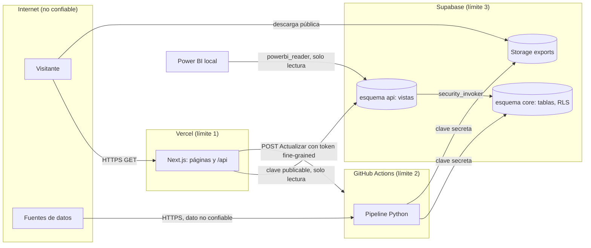

# Modelo de amenazas

Sitio público de solo lectura, sin cuentas. La superficie es chica; igual se trata como producción:
seguridad por diseño, defensa en profundidad y mínimo privilegio (sección 14).

## Activos

| Activo | Por qué importa |
|---|---|
| Integridad de los datos publicados | Un número alterado daña la credibilidad del análisis y del dueño |
| Clave secreta de Supabase | Salta la RLS: escritura total en la base y en Storage |
| Tokens de fuentes (StrikerAPI, Bzzoiro, API-Football) y de GitHub (botón Actualizar) | Consumo de cuota ajena, corridas en cadena |
| Disponibilidad del sitio y de la base | Supabase Free se pausa sin actividad; Vercel Hobby tiene límites |
| Reputación del dueño | Proyecto de portfolio: un sitio desfigurado o con datos personales de más se ve |

## Actores

- **Bots y escáneres automáticos** (los más probables): buscan `/.env`, `/wp-admin`, claves en el bundle.
- **Atacante oportunista**: prueba parámetros de URL, inyección, abuso del botón Actualizar.
- **Dependencia comprometida** (npm, PyPI, acción de GitHub).
- **Fuente que devuelve contenido malicioso o alterado** (HTML con scripts, números absurdos).
- **Error propio**: una migración que expone una tabla, una clave pegada en un commit.

## Flujo de datos y límites de confianza

## STRIDE por componente

| Componente | Amenaza | Control |
|---|---|---|
| Web (Vercel) | **S**poofing de origen en el botón Actualizar | POST solo si `Origin` coincide; enfriamiento de 60 min; concurrencia 1 |
| Web | **T**ampering vía parámetros de URL | Zod con listas cerradas y rangos; valor inválido vuelve al defecto; sin `dangerouslySetInnerHTML` |
| Web | **I**nformation disclosure de claves | Cliente en módulos `server-only`; CI busca `sb_secret_` en `.next/static`; sin source maps |
| Web | XSS y clickjacking | CSP con nonce y `strict-dynamic`, `frame-ancestors 'none'`, `object-src 'none'` (ADR 0003) |
| Web | **D**oS | Mitigación de la plataforma; caché de datos de 6 h; páginas sin consultas costosas |
| Base | **E**levation con la clave pública | Tablas en `core` no expuesto; `anon` solo SELECT en vistas; RLS en todo; sin políticas de escritura; `statement_timeout` de 3 s |
| Base | **T**ampering de datos | Solo el pipeline escribe, con la clave secreta en GitHub Secrets; `audit_log` |
| Base | **R**epudiation | `ingest_log` y `audit_log` con SHA del commit y resultado de cada corrida |
| Storage | **T**ampering de los libros | Escritura solo con la clave secreta; tamaño máximo y MIME permitidos; test de RLS |
| Pipeline | Fuente maliciosa (**T**) | Validación con pydantic; cuarentena; textos como texto; resguardo contra fórmulas en Excel y CSV |
| Pipeline | **I**nformation disclosure en logs | Filtro de `logging` que enmascara claves; las claves no se imprimen nunca |
| CI/CD | Dependencia o acción comprometida | Lockfiles congelados; acciones por SHA; Dependabot, CodeQL, Semgrep, pip-audit, pnpm audit |
| CI/CD | Clave en el repositorio | gitleaks en cada push y semanal sobre todo el historial |
| Power BI | Contraseña filtrada en un `.pbix` | `powerbi_reader` solo lectura, mismo alcance que la web pública; revocable con `nologin` |

## Riesgos

Ver [`risk_register.csv`](risk_register.csv); se revisa al cerrar cada etapa.
